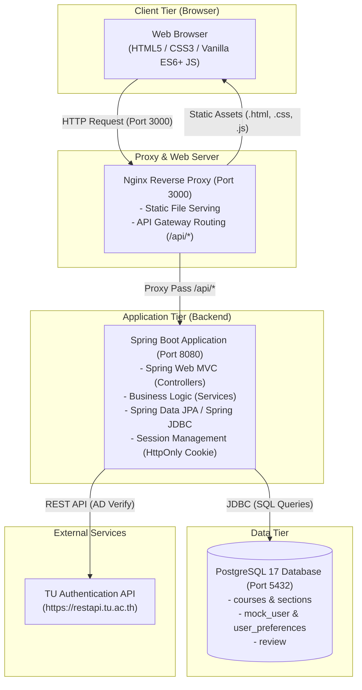
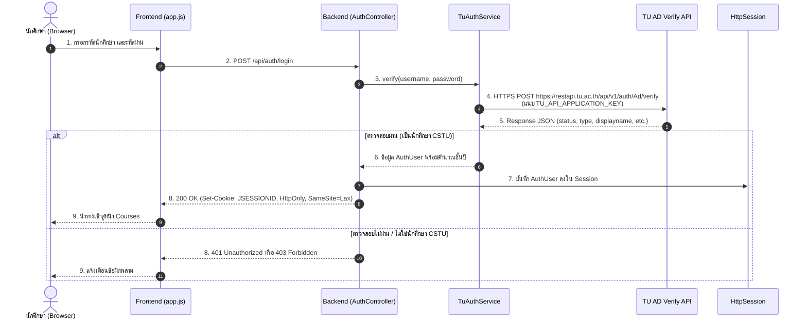
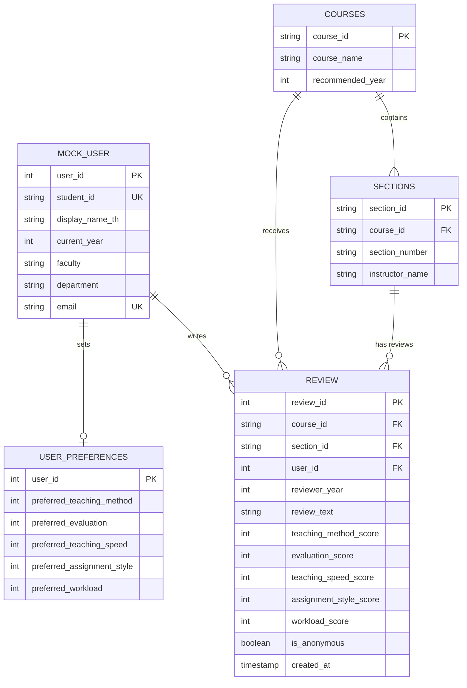
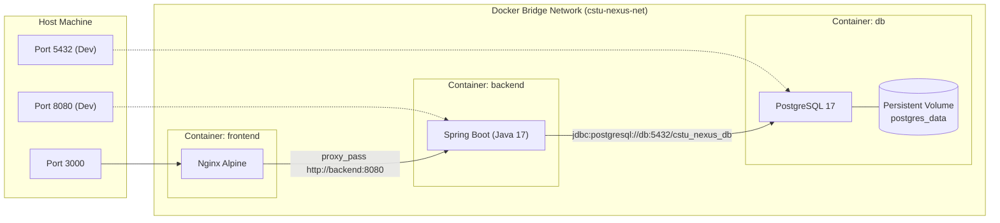

# CSTU-NEXUS — System Architecture Documentation

เอกสารอธิบายสถาปัตยกรรมระบบ **CSTU-NEXUS** (ระบบสนับสนุนการตัดสินใจเลือกเรียนและรีวิวรายวิชา CSTU) ครอบคลุมรูปแบบการออกแบบเชิงสถาปัตยกรรม (Architectural Pattern), การแบ่งเลเยอร์ (Layered Architecture), รูปแบบ Boundary-Control-Entity (BCE), ระบบรักษาความปลอดภัย, สถาปัตยกรรมข้อมูล และโครงสร้างการติดตั้งระบบ (Deployment Architecture)

---

## สารบัญ
1. [ภาพรวมสถาปัตยกรรมระบบ (System Architecture Overview)](#1-ภาพรวมสถาปัตยกรรมระบบ-system-architecture-overview)
2. [สถาปัตยกรรมแบบ 3-Tier Layered Architecture](#2-สถาปัตยกรรมแบบ-3-tier-layered-architecture)
3. [Boundary-Control-Entity (BCE) Pattern](#3-boundary-control-entity-bce-pattern)
4. [สถาปัตยกรรมการยืนยันตัวตนและความปลอดภัย (Security & Authentication Architecture)](#4-สถาปัตยกรรมการยืนยันตัวตนและความปลอดภัย-security--authentication-architecture)
5. [สถาปัตยกรรมข้อมูล (Data & Database Architecture)](#5-สถาปัตยกรรมข้อมูล-data--database-architecture)
6. [สถาปัตยกรรมการติดตั้งระบบ (Deployment & Container Architecture)](#6-สถาปัตยกรรมการติดตั้งระบบ-deployment--container-architecture)
7. [Tech Stack Specification](#7-tech-stack-specification)

---

## 1. ภาพรวมสถาปัตยกรรมระบบ (System Architecture Overview)

ระบบ CSTU-NEXUS ออกแบบโดยใช้หลักการ **Decoupled Architecture** แยกส่วนแสดงผล (Frontend) และส่วนประมวลผลเซิร์ฟเวอร์ (Backend) ออกจากกันอย่างเป็นอิสระ สื่อสารกันผ่าน **RESTful API (JSON over HTTP/HTTPS)** โดยมี Reverse Proxy (Nginx) คอยควบคุมทราฟฟิกและจัดการ Same-Origin Policy

---

## 2. สถาปัตยกรรมแบบ 3-Tier Layered Architecture

ระบบแบ่งออกเป็น 3 เลเยอร์หลักตามมาตรฐานระดับองค์กร:

### 2.1 Presentation Tier (Frontend)
- **โครงสร้าง:** Single Page / Multi-page Static Web pages พัฒนาด้วย Vanilla HTML5, CSS3 และ JavaScript (ES6+) โดยไม่พึ่งพา Frontend Framework ขนาดใหญ่ เพื่อประสิทธิภาพสูงสุด โหลดเร็ว และดูแลรักษาง่าย
- **หน้าที่:**
  - แสดงผล UI แบบ Mobile-first Responsive Design
  - รับข้อมูลจากผู้ใช้และตรวจสอบความถูกต้องเบื้องต้น (Client-side Validation)
  - เรียกใช้ REST API ผ่าน `fetch` API พร้อมแนบ Session Cookie
  - จัดการ State ของหน้าจอและการนำทาง (Navigation State)

### 2.2 Application Tier (Backend)
- **โครงสร้าง:** Spring Boot 4.1.x (Java 17) แบ่งเป็นเลเยอร์ย่อยภายใน:
  - **Controller Layer:** รับ HTTP Request, ตรวจสอบ Authentication Session, และส่ง Response แบบ JSON
  - **Service Layer:** ประมวลผล Business Logic เช่น การคำนวณชั้นปีจากรหัสนักศึกษา, การตรวจสอบสิทธิ์การรีวิว (Eligibility Rule: `currentYear > recommendedYear`), และอัลกอริทึมคำนวณ Match Score
  - **Data Access Layer (Repository / DAO):** เชื่อมโยงฐานข้อมูลผ่าน Spring Data JPA และ `JdbcTemplate`
- **หน้าที่:** ควบคุมกฎเกณฑ์ของระบบทั้งหมด (Business Integrity) โดยไม่พึ่งพาข้อมูลจาก Client เพียงอย่างเดียว

### 2.3 Data Tier (Database)
- **โครงสร้าง:** PostgreSQL 17 Relational Database รันบน Docker Container พร้อม persistent storage volume
- **หน้าที่:** จัดเก็บข้อมูลรายวิชา, เซกชัน, ข้อมูลผู้ใช้งานจำลอง, ความพึงพอใจในการเรียน (User Preferences), และข้อมูลการรีวิว

---

## 3. Boundary-Control-Entity (BCE) Pattern

ระบบประยุกต์ใช้แพตเทิร์น **BCE (Boundary, Control, Entity)** ตามมาตรฐานการวิเคราะห์และออกแบบระบบเชิงวัตถุ (Object-Oriented Analysis & Design):

| BCE Role | คอมโพเนนต์ในระบบ | รายละเอียดหน้าที่ |
|---|---|---|
| **Boundary** | `index.html`, `courses.html`, `course-detail.html`, `write-review.html`, `preference.html`, `profile.html`, `app.js` | ส่วนประสานงานระหว่างผู้ใช้กับระบบ รับอินพุต แสดงผล และแปลง Event ของผู้ใช้เป็นการเรียก API |
| **Control** | `AuthController`, `CourseController`, `ReviewController`, `PreferenceController`, `MatchScoreController` `TuAuthService`, `ReviewService`, `PreferenceService`, `MatchScoreService`, `StudyYearCalculator` | คลาสผู้ควบคุม ทำหน้าที่ประสานงานระหว่าง Boundary และ Entity ควบคุม Workflow, Business Rules และการคำนวณ |
| **Entity** | `AuthUser`, `CourseDetail`, `Section`, `Review`, `UserPreferences`, `MatchScoreResult` | ตัวแทนของข้อมูลเชิงธุรกิจ (Business Data) ที่คงอยู่ (Persisted) ในระบบหรือ Session |

---

## 4. สถาปัตยกรรมการยืนยันตัวตนและความปลอดภัย (Security & Authentication Architecture)

### กลไกความปลอดภัยหลัก:
1. **Zero Secret on Frontend:** ตัวแปรลับ `TU_API_APPLICATION_KEY` จะถูกเก็บไว้ที่ Environment Variables ของเซิร์ฟเวอร์ Backend เท่านั้น ไม่มีการเปิดเผยสู่ Browser หรือโค้ดฝั่ง Client
2. **HttpOnly Session Cookies:** ไม่เก็บ JWT หรือ Token ใดๆ ลงใน `localStorage` เพื่อป้องกันการโจมตีประเภท Cross-Site Scripting (XSS)
3. **Role & Eligibility Enforcement:**
   - ตรวจสอบสิทธิ์ที่ฝั่ง Backend เสมอ (Server-side Validation)
   - สิทธิ์การเขียนรีวิว: ผู้ใช้ต้องล็อกอิน และต้องมีชั้นปีปัจจุบันสูงกว่าชั้นปีแนะนำของรายวิชานั้น (`currentYear > recommendedYear`) พร้อมป้องกันการส่งรีวิวซ้ำ
4. **Anonymous Review Privacy:** การรีวิวแบบปกปิดตัวตน (`isAnonymous = true`) ระบบจะ Mask รหัสนักศึกษาให้เหลือเฉพาะปีรุ่น (เช่น `68********`) เพื่อปกป้องความเป็นส่วนตัวของนักศึกษา

---

## 5. สถาปัตยกรรมข้อมูล (Data & Database Architecture)

ฐานข้อมูลได้รับการออกแบบในระดับ Third Normal Form (3NF) เพื่อลดความซ้ำซ้อนของข้อมูลและรักษาความถูกต้องสมบูรณ์ (Referential Integrity):

---

## 6. สถาปัตยกรรมการติดตั้งระบบ (Deployment & Container Architecture)

ระบบรองรับการรันผ่าน **Docker Compose** แบบ Multi-container Network:

- **Reverse Proxy Advantage:** ผู้ใช้เข้าใช้งานผ่าน `http://localhost:3000` โดย Nginx จะ Forward คำขอ `/api/*` ไปยัง `http://backend:8080` อัตโนมัติ ทำให้หมดปัญหาเรื่อง Cross-Origin Resource Sharing (CORS) และ Cookies Domain
- **Data Persistence:** ใช้ Docker Named Volume `postgres_data` เพื่อให้ข้อมูลใน Database คงอยู่แม้สั่งปิดหรือ Restart Container

---

## 7. Tech Stack Specification

| ด้าน | เทคโนโลยี | เวอร์ชัน | เหตุผลความจำเป็นในการเลือกใช้ |
|---|---|---|---|
| **Frontend** | HTML5, CSS3, JavaScript ES6+ | Modern Standard | เบา โหลดเร็ว ไม่ต้อง build tool หรือ node_modules |
| **Reverse Proxy** | Nginx | Alpine Linux | เสิร์ฟ static assets และทำ reverse proxy เชื่อมต่อ Backend แบบ Same-Origin |
| **Backend** | Java, Spring Boot | Java 17, Spring Boot 4.1.x | Robust Enterprise Framework รองรับ MVC, JPA, Connection Pool |
| **Database** | PostgreSQL | 17 | Relational Database ประสิทธิภาพสูง รองรับ ACID และ Migration Scripts |
| **Containerization** | Docker, Docker Compose | v2+ | ควบคุมสภาพแวดล้อมการทำงานให้เหมือนกันทุกคนในทีม |
| **External API** | Thammasat AD Verify API | v1 | ตรวจสอบสถานะการเป็นนักศึกษาจริงของมหาวิทยาลัยธรรมศาสตร์ |
