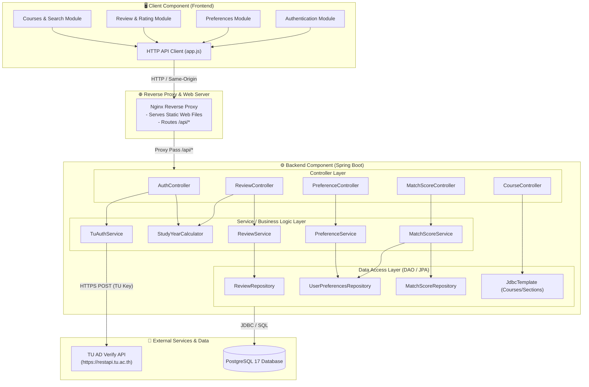
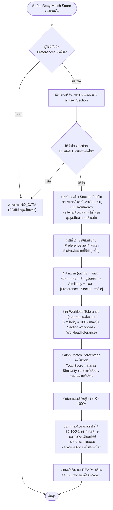
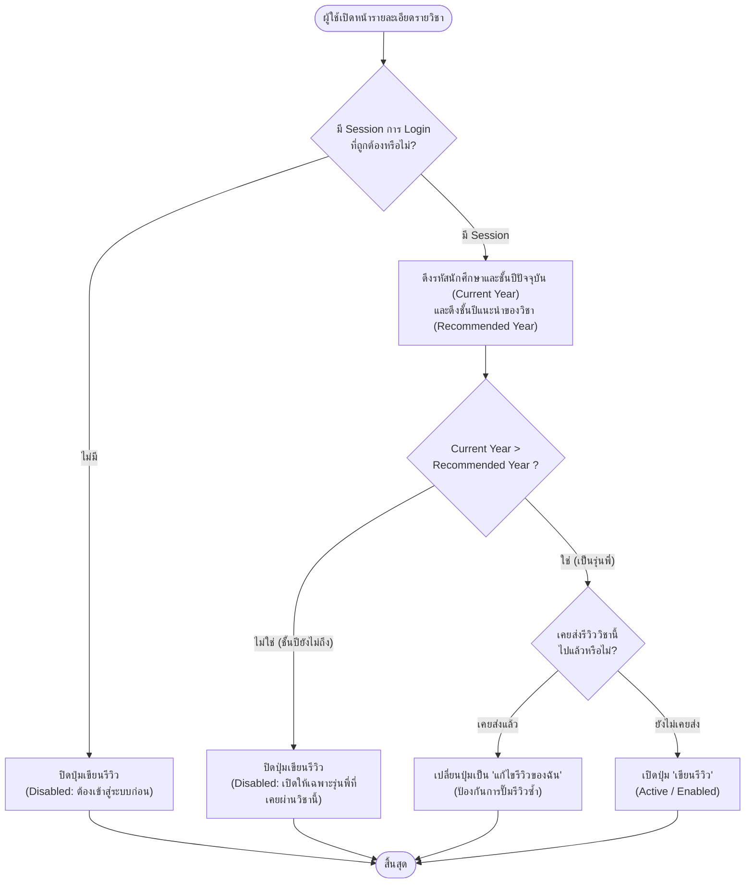
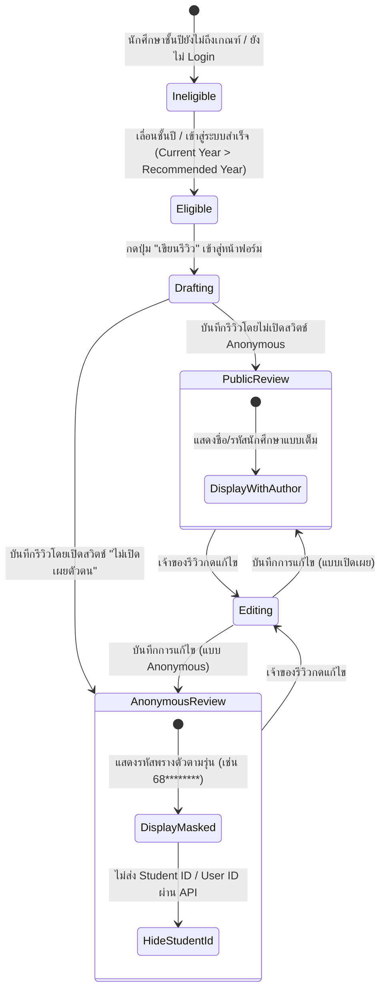
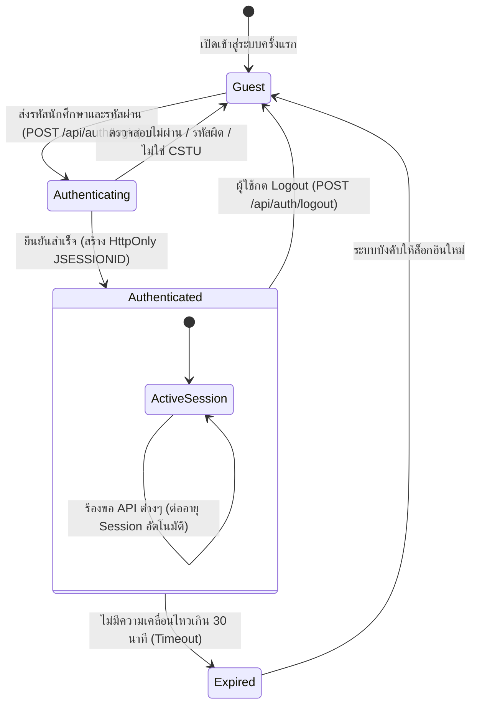

# CSTU-NEXUS — Recommended UML Diagrams

เอกสารรวบรวมคำแนะนำและโค้ดแผนภาพ (Mermaid Diagrams) เพิ่มเติมที่ควรจัดทำสำหรับโครงงาน **CS261 / CS264 Introduction to Software Engineering** เพื่อให้รายงานและเอกสารส่งอาจารย์มีความสมบูรณ์ตามหลักการวิเคราะห์และออกแบบระบบเชิงวัตถุ (OOAD)

---

## สารบัญแผนภาพแนะนำ
1. [Component Diagram (แผนภาพส่วนประกอบระบบ)](#1-component-diagram-แผนภาพส่วนประกอบระบบ)
2. [Activity Diagram: Flow การคำนวณ Match Score Algorithm](#2-activity-diagram-flow-การคำนวณ-match-score-algorithm)
3. [Activity Diagram: Flow การตรวจสอบสิทธิ์เขียนรีวิว (Eligibility Rule)](#3-activity-diagram-flow-การตรวจสอบสิทธิ์เขียนรีวิว-eligibility-rule)
4. [State Machine Diagram: สถานะการรีวิวและโหมดปกปิดตัวตน (Review Lifecycle)](#4-state-machine-diagram-สถานะการรีวิวและโหมดปกปิดตัวตน-review-lifecycle)
5. [State Machine Diagram: วงจรชีวิตของ Session ผู้ใช้งาน (User Authentication Lifecycle)](#5-state-machine-diagram-วงจรชีวิตของ-session-ผู้ใช้งาน-user-authentication-lifecycle)

---

## 1. Component Diagram (แผนภาพส่วนประกอบระบบ)

> 💡 **เหตุผลที่ควรมี:** อาจารย์มักให้ความสำคัญกับการแสดงการแยกส่วน (Modularization) ระหว่าง Frontend Components, Backend Layers และ External Services เพื่อแสดงให้เห็นการเชื่อมต่อผ่าน REST Protocols และ Database Interfaces

---

## 2. Activity Diagram: Flow การคำนวณ Match Score Algorithm

> 💡 **เหตุผลที่ควรมี:** ฟีเจอร์ Match Score เป็นจุดเด่น (Key Innovation) ของระบบ CSTU-NEXUS การมี Activity Diagram จะช่วยอธิบายวิธีการคำนวณ 2 รอบ (รอบ Section Profile Consensus และรอบ Student Similarity) ได้อย่างชัดเจนในการนำเสนอ

---

## 3. Activity Diagram: Flow การตรวจสอบสิทธิ์เขียนรีวิว (Eligibility Rule)

> 💡 **เหตุผลที่ควรมี:** แสดงการควบคุม Business Rule อย่างเข้มงวดของระบบ (U3 & U5)

---

## 4. State Machine Diagram: สถานะการรีวิวและโหมดปกปิดตัวตน (Review Lifecycle)

> 💡 **เหตุผลที่ควรมี:** แสดงวงจรชีวิตของรีวิวตั้งแต่ยังไม่มีสิทธิ์ จนถึงการบันทึกแบบเปิดเผยตัวตน หรือแบบ Anonymous Masking

---

## 5. State Machine Diagram: วงจรชีวิตของ Session ผู้ใช้งาน (User Authentication Lifecycle)

> 💡 **เหตุผลที่ควรมี:** แสดงการจัดการ Session และความปลอดภัย (Security Architecture)

