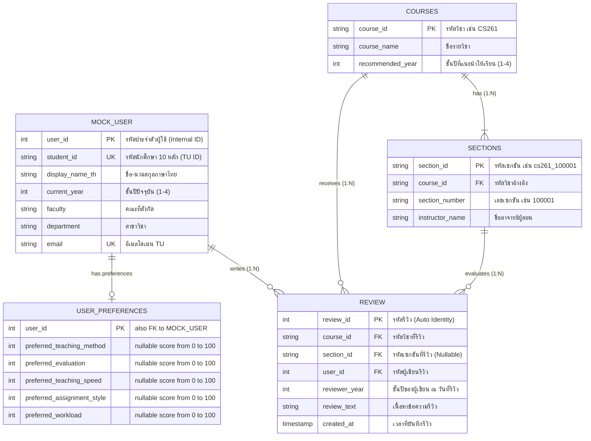
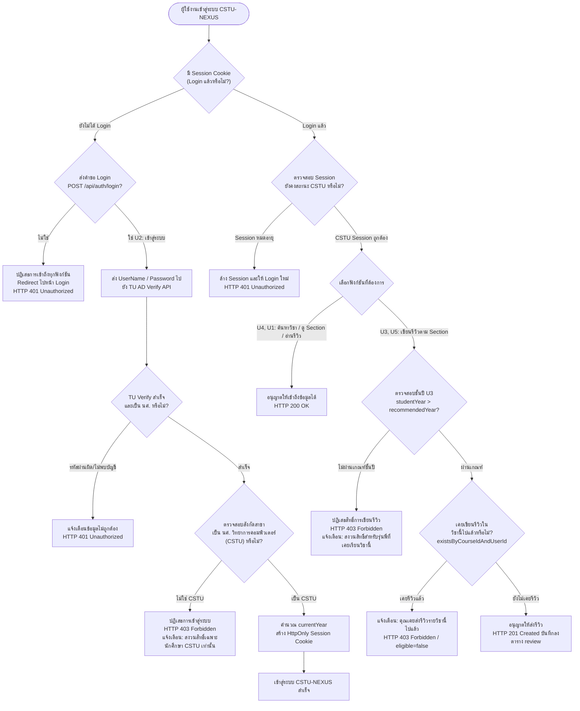

# CSTU-NEXUS — Entity, Database Table Mapping & API-DAO Specification

เอกสารอธิบายการออกแบบสถาปัตยกรรมข้อมูล ความสัมพันธ์ระหว่าง Entity กับ Database Table, การจับคู่ API กับ DAO (Data Access Object), และ Permission Flow สำหรับระบบ **CSTU-NEXUS** รวมถึง API และฐานข้อมูล Preferences ของ U7

---

## สารบัญ
1. [Entity & Database Table Mapping](#1-entity--database-table-mapping)
2. [ตารางความสัมพันธ์ API ↔ Controller ↔ DAO ↔ Database](#2-ตารางความสัมพันธ์-api--controller--dao--database)
3. [Permission Flow & Verification Matrix](#3-permission-flow--verification-matrix)
4. [U7 Learning Preferences API & Database](#4-u7-learning-preferences-api--database)

---

## 1. Entity & Database Table Mapping

ความสัมพันธ์ระหว่าง Entity หลักของระบบจำลองตามสถาปัตยกรรมฐานข้อมูล PostgreSQL 17 (`init.sql`) รวมถึงข้อมูล Preferences ของผู้ใช้ที่ล็อกอิน:

### 1.1 แผนภาพความสัมพันธ์ (Entity & Database Table Mapping)

```text
+------------------+         +--------------------+         +--------------------+
|    mock_user     |         |      courses       |         |      sections      |
+------------------+         +--------------------+         +--------------------+
| PK user_id       |         | PK course_id       | 1     * | PK section_id      |
|    student_id    |         |    course_name     |---------| FK course_id       |
|    display_name  |         |    recommended_year|         |    section_number  |
|    current_year  |         +--------------------+         |    instructor_name |
+------------------+                   | 1                  +--------------------+
         | 1                           |                               | 1
         |                             |                               |
         |                             | *                             | *
         |                    +------------------+                     |
         +------------------->|      review      |<--------------------+
                            * +------------------+
                              | PK review_id     |
                              | FK course_id     |
                              | FK section_id    |
                              | FK user_id       |
                              |    reviewer_year |
                              |    review_text   |
                              |    created_at    |
                              +------------------+
```

### 1.2 Mermaid ER Diagram

<!-- mermaid-checked: every attribute is `<type> <name> [<key>] ["<description>"]` with at most one of PK/FK/UK, no \n in descriptions, no {} in descriptions, every relationship label is double-quoted -->


### 1.3 โครงสร้าง Entity Mapping ใน Java (Spring Boot)

| Java Model / Entity Record | Database Table | Primary Key | Foreign Keys / Constraints | หน้าที่หลัก |
|---|---|---|---|---|
| `AuthUser` / `User` | `mock_user` | `user_id` | `student_id` (UNIQUE), `email` (UNIQUE) | ข้อมูลโปรไฟล์ผู้ใช้งานและสถานะการยืนยันตัวตน |
| `CourseDetail` / `CourseSummary` | `courses` | `course_id` | `recommended_year` (CHECK 1-4) | ข้อมูลรายวิชาในหลักสูตร CSTU |
| `Section` | `sections` | `section_id` | `course_id` $\rightarrow$ `courses(course_id)` | รายการเซกชันและอาจารย์ผู้สอนของแต่ละวิชา |
| `Review` / `ReviewResponse` | `review` | `review_id` | `course_id`, `section_id`, `user_id` | ข้อมูลความคิดเห็นและการประเมินรายวิชา/เซกชัน |
| `UserPreferences` | `user_preferences` | `user_id` | `user_id` $\rightarrow$ `mock_user(user_id)` (one-to-one) | ความชอบในการเรียนและระดับ Workload ของผู้ใช้ |

---

## 2. ตารางความสัมพันธ์ API ↔ Controller ↔ Data Access (DAO / Repository) ↔ Database

| Use Case | HTTP Method & Endpoint | Controller & Method | Data Access Layer (Service / Repository / DAO) | ตาราง Database | คำสั่ง SQL / การทำงาน |
|:---:|---|---|---|:---:|---|
| **U2** | `POST /api/auth/login` | `AuthController`<br>`.login(request, servletRequest)` | `TuAuthService`<br>`.verify(username, password)` | - *(External API)* | เรียก TU AD Verify API ตรวจสอบรหัสนักศึกษาและรหัสผ่าน พร้อมคัดกรองสังกัด CSTU แล้วบันทึก `AuthUser` ลง Session |
| **U2** | `GET /api/auth/me` | `AuthController`<br>`.currentUser(request)` | *(อ่านจาก HttpSession)* | - | ดึง `AuthUser` จาก Session เพื่อตรวจสอบสถานะการเข้าสู่ระบบและข้อมูลผู้ใช้ |
| **U2** | `POST /api/auth/logout` | `AuthController`<br>`.logout(request)` | *(ทำลาย HttpSession)* | - | `session.invalidate()` ล้าง Session Cookie ผู้ใช้ |
| **U4** | `GET /api/courses`<br>`?keyword=&year=` | `CourseController`<br>`.searchCourses(keyword, year)` | `JdbcTemplate`<br>*(Direct Query Pattern)* | `courses`<br>`sections` | `SELECT c.course_id, c.course_name, c.recommended_year, COUNT(s.section_id) FROM courses c LEFT JOIN sections s ON s.course_id = c.course_id WHERE ... GROUP BY c.course_id ORDER BY c.course_id` |
| **U4** | `GET /api/courses/{id}` | `CourseController`<br>`.getCourse(id)` | `JdbcTemplate`<br>*(Direct Query Pattern)* | `courses`<br><br>`sections` | `SELECT course_id, course_name, recommended_year FROM courses WHERE UPPER(course_id) = ?`<br><br>`SELECT section_id, section_number, instructor_name FROM sections WHERE course_id = ? ORDER BY section_number, section_id` |
| **U1** | `GET /api/courses/{id}/reviews`<br>`?sectionId=` | `ReviewController`<br>`.getReviews(id, sectionId)` | `ReviewService`<br>`.getReviews(courseId, sectionId)`<br><br>`ReviewRepository`<br>*(Spring Data JPA)* | `review` | `findByCourseIdOrderByCreatedAtDesc` หรือ `findByCourseIdAndSectionIdOrderByCreatedAtDesc`<br>ดึงรายการรีวิวทั้งหมดของวิชา/เซกชัน เรียงจากใหม่ไปเก่า |
| **U3** | `GET /api/courses/{id}/reviews/eligibility` | `ReviewController`<br>`.checkReviewEligibility(id, session)` | `ReviewService`<br>`.getEligibilityStatus(studentId, courseId)`<br><br>`ReviewRepository`<br>`.existsByCourseIdAndUserId(...)`<br><br>`StudyYearCalculator`<br>`.calculate(studentId)` | `courses`<br>`review` | ตรวจสอบว่านักศึกษา CSTU มีชั้นปีปัจจุบัน (`studentYear`) > `recommended_year` และยังไม่เคยเขียนรีวิวในวิชานี้ (`!alreadyReviewed`) |
| **U5** | `POST /api/courses/{id}/reviews` | `ReviewController`<br>`.submitReview(id, review, session)` | `ReviewService`<br>`.saveReview(review)`<br><br>`ReviewRepository`<br>`.save(review)` *(JPA)* | `review` | ตรวจสอบสิทธิ์ U3 ซ้ำฝั่ง Backend จากนั้นตั้งค่า `userId`, `reviewerYear`, `createdAt` และบันทึกลงตาราง `review` ผ่าน JPA |
| **U7** | `GET /api/users/preferences` | `UserPreferencesController`<br>`.getPreferences(request)` | `UserPreferencesService`<br>`.getForUser(authUser)`<br><br>`UserPreferencesRepository`<br>`.findByUserId(userId)` | `mock_user`<br>`user_preferences` | ใช้ผู้ใช้จาก Session, upsert `mock_user` เพื่อให้มี FK แล้วอ่าน Preferences; ถ้ายังไม่มีข้อมูลให้คืนค่า 5 ฟิลด์เป็น `null` |
| **U7** | `PUT /api/users/preferences` | `UserPreferencesController`<br>`.savePreferences(preferences, request)` | `UserPreferencesService`<br>`.saveForUser(authUser, preferences)`<br><br>`UserPreferencesRepository`<br>`.save(userId, preferences)` | `mock_user`<br>`user_preferences` | ใช้ `user_id` จาก Session และ upsert ข้อมูลด้วย `ON CONFLICT`; ไม่รับ user ID จาก Request Body |

---

## 3. Permission Flow & Verification Matrix

ผังการตรวจสอบสิทธิ์ (Authentication & Year-based Eligibility Flow) ภายใต้เงื่อนไข **"ต้อง Login และเป็นนักศึกษา CSTU เท่านั้นจึงจะเข้าใช้งานระบบได้"**:

### 3.1 ตารางกำหนดสิทธิ์ตามกลุ่มผู้ใช้ (Permission Matrix)

| บทบาท / กลุ่มผู้ใช้ | ยืนยันตัวตน (U2) | ค้นหา & ดูวิชา/Section (U4) | อ่านรีวิวจากรุ่นพี่ (U1) | ตรวจสอบชั้นปีก่อนรีวิว (U3) | เขียนรีวิวตาม Section (U5) |
|---|:---:|:---:|:---:|:---:|:---:|
| **Guest (ยังไม่ล็อกอิน)** | ✅ ทำได้ (ยื่นฟอร์ม) | ❌ **ต้อง Login ก่อน** | ❌ **ต้อง Login ก่อน** | ❌ **ต้อง Login ก่อน** | ❌ ไม่อนุญาต |
| **นักศึกษา TU อื่นๆ (ไม่ใช่ CSTU)** | ⚠️ ผ่าน TU AD แต่ถูกปฏิเสธ* | ❌ **ไม่อนุญาต (ไม่ใช่ CSTU)** | ❌ **ไม่อนุญาต (ไม่ใช่ CSTU)** | ❌ ไม่อนุญาต | ❌ ไม่อนุญาต |
| **นักศึกษา CSTU ปี 1 (`currentYear = 1`)** | ✅ สำเร็จ (CSTU Verified) | ✅ เข้าถึงได้ | ✅ เข้าถึงได้ | ⚠️ ไม่ผ่านเกณฑ์** | ❌ ไม่อนุญาตตามเกณฑ์ U3** |
| **นักศึกษา CSTU รุ่นพี่ปี 2–4 (`currentYear >= 2`)** | ✅ สำเร็จ (CSTU Verified) | ✅ เข้าถึงได้ | ✅ เข้าถึงได้ | ✅ **ผ่านเกณฑ์ U3** | ✅ **มีสิทธิ์เขียนรีวิว** |

*\*เงื่อนไข CSTU Gatekeeper: ระบบจะตรวจสอบ Department/Faculty หากไม่ใช่สาขาวิชาวิทยาการคอมพิวเตอร์ จะถูกปฏิเสธสิทธิ์ด้วย HTTP 403 Forbidden  
\*\*เงื่อนไข U3: นักศึกษาจะเขียนรีวิววิชาได้เมื่อมีชั้นปีปัจจุบัน $\ge$ ชั้นปีที่แนะนำ (`recommended_year`) ของวิชานั้นๆ (เช่น วิชาปี 2 สงวนสิทธิ์ให้ นศ. CSTU ปี 2 ขึ้นไปที่เคยเรียนแล้วเป็นผู้รีวิว)*

### 3.2 แผนผังกระบวนการตรวจสอบสิทธิ์ (Permission Flowchart)



## 4. U7 Learning Preferences API & Database

### 4.1 Database: `user_preferences`

ตารางนี้เก็บ Preferences ได้หนึ่งแถวต่อผู้ใช้ โดย `user_id` เป็นทั้ง Primary Key และ Foreign Key ไปยัง `mock_user(user_id)` พร้อม `ON DELETE CASCADE` ฟิลด์คะแนนทั้งห้าเป็น nullable เพื่อรองรับการยังไม่เลือกบางหัวข้อ และมีข้อกำหนดให้ค่าที่ไม่เป็น `null` อยู่ในช่วง 0-100 เช่นเดียวกับคะแนนรีวิว

| Column | Type | Constraint | ความหมาย |
|---|---|---|---|
| `user_id` | `INTEGER` | `PRIMARY KEY`, `FOREIGN KEY` → `mock_user(user_id)` | ผู้ใช้เจ้าของ Preferences |
| `preferred_teaching_method` | `INTEGER` | `NULL` หรือ 0-100 | แนวทางการสอน |
| `preferred_evaluation` | `INTEGER` | `NULL` หรือ 0-100 | สัดส่วนการวัดผล |
| `preferred_teaching_speed` | `INTEGER` | `NULL` หรือ 0-100 | ความเร็วในการสอน |
| `preferred_assignment_style` | `INTEGER` | `NULL` หรือ 0-100 | รูปแบบงาน |
| `preferred_workload` | `INTEGER` | `NULL` หรือ 0-100 | ระดับ Workload |

การแปลงค่าจากหน้า Preference ปัจจุบันเป็นคะแนน API/Database:

| UI field | Database/API field |
|---|---|
| `teachingApproach` | `preferredTeachingMethod` |
| `gradingStyle` | `preferredEvaluation` |
| `teachingPace` | `preferredTeachingSpeed` |
| `assignmentStyle` | `preferredAssignmentStyle` |
| `workload` | `preferredWorkload` |

| ค่าที่เลือกใน UI | คะแนนที่ส่ง |
|---|---:|
| Rating 1-3 | 0, 50, 100 ตามลำดับ |
| Rating 1-5 | 0, 25, 50, 75, 100 ตามลำดับ |
| ยังไม่เลือก | `null` |

### 4.2 API Contract

ทั้งสอง endpoint ต้องใช้ Session ที่ผ่านการยืนยันตัวตนแล้ว Backend จะอ่าน `AuthUser` จาก Session และ resolve `user_id` เอง ผู้เรียกไม่สามารถกำหนดหรือแก้ไขเจ้าของ Preferences ผ่าน Request Body ได้

| Method | Endpoint | Request | Response |
|---|---|---|---|
| `GET` | `/api/users/preferences` | ไม่มี | `200 OK` พร้อมคะแนนทั้งห้า; หากยังไม่มีแถวจะคืนทุกฟิลด์เป็น `null` |
| `PUT` | `/api/users/preferences` | JSON ของคะแนนทั้งห้า; ฟิลด์ละ `null` ได้ | `200 OK` พร้อมค่าที่บันทึกแล้ว |

Request และ response ตัวอย่าง:

```json
{
  "preferredTeachingMethod": 100,
  "preferredEvaluation": 50,
  "preferredTeachingSpeed": 75,
  "preferredAssignmentStyle": null,
  "preferredWorkload": 25
}
```

ตัวอย่างเรียก API จากหน้าเว็บ (Session Cookie จะถูกส่งไปกับ request):

```javascript
const response = await fetch("/api/users/preferences", {
  method: "PUT",
  credentials: "include",
  headers: { "Content-Type": "application/json" },
  body: JSON.stringify({
    preferredTeachingMethod: 100,
    preferredEvaluation: 50,
    preferredTeachingSpeed: 75,
    preferredAssignmentStyle: null,
    preferredWorkload: 25
  })
});

if (!response.ok) {
  throw new Error(`Saving preferences failed: ${response.status}`);
}
```

ถ้ายังไม่มีข้อมูล `GET /api/users/preferences` จะตอบกลับด้วย HTTP 200 และ body:

```json
{
  "preferredTeachingMethod": null,
  "preferredEvaluation": null,
  "preferredTeachingSpeed": null,
  "preferredAssignmentStyle": null,
  "preferredWorkload": null
}
```

`PUT` เป็นการแทนที่ชุด Preferences ทั้งชุด: ฟิลด์ที่ไม่ส่งหรือส่งเป็น `null` จะถูกเก็บเป็น `null` ไม่ใช่คงค่ารอบก่อนหน้า คะแนนที่ไม่ใช่จำนวนเต็มหรืออยู่นอกช่วง 0-100 จะได้รับ `400 Bad Request`; ไม่มี Session จะได้รับ `401 Unauthorized`; และเมื่อฐานข้อมูลไม่พร้อมใช้งานจะได้รับ `503 Service Unavailable` โดยไม่มีการตอบกลับในรูปแบบสำเร็จ
