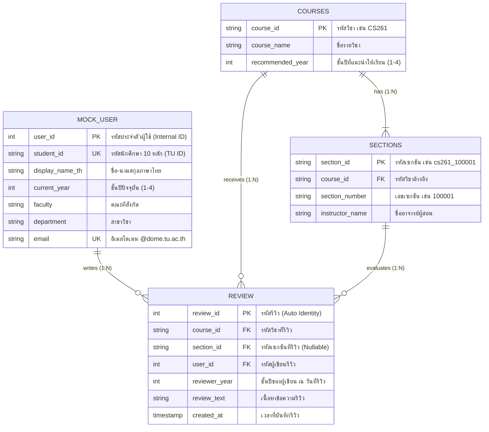

# CSTU-NEXUS — Entity, Database Table Mapping & API-DAO Specification

เอกสารอธิบายการออกแบบสถาปัตยกรรมข้อมูล ความสัมพันธ์ระหว่าง Entity กับ Database Table, การจับคู่ API กับ DAO (Data Access Object), และ Permission Flow สำหรับระบบ **CSTU-NEXUS**

---

## สารบัญ
1. [Entity & Database Table Mapping](#1-entity--database-table-mapping)
2. [ตารางความสัมพันธ์ API ↔ Controller ↔ DAO ↔ Database](#2-ตารางความสัมพันธ์-api--controller--dao--database)
3. [Permission Flow & Verification Matrix](#3-permission-flow--verification-matrix)

---

## 1. Entity & Database Table Mapping

ความสัมพันธ์ระหว่าง Entity หลักของระบบจำลองตามสถาปัตยกรรมฐานข้อมูล PostgreSQL 17 (`init.sql`):

### 1.1 แผนภาพความสัมพันธ์ (Entity & Database Table Mapping)

```text
+------------------+         +--------------------+         +--------------------+
|    mock_user     |         |      courses       |         |      sections      |
+------------------+         +--------------------+         +--------------------+
| PK user_id       |         | PK course_id       | 1     * | PK section_id      |
|    student_id    |         |    course_name     |---------| FK course_id       |
|    display_name  |         |    recommended_year|         |    section_number  |
|    current_year  |         +--------------------+         |    instructor_name |
+------------------+                   | 1                  +--------------------+
         | 1                           |                               | 1
         |                             |                               |
         |                             | *                             | *
         |                    +------------------+                     |
         +------------------->|      review      |<--------------------+
                            * +------------------+
                              | PK review_id     |
                              | FK course_id     |
                              | FK section_id    |
                              | FK user_id       |
                              |    reviewer_year |
                              |    review_text   |
                              |    created_at    |
                              +------------------+
```

### 1.2 Mermaid ER Diagram



### 1.2 โครงสร้าง Entity Mapping ใน Java (Spring Boot)

| Java Model / Entity Record | Database Table | Primary Key | Foreign Keys / Constraints | หน้าที่หลัก |
|---|---|---|---|---|
| `AuthUser` / `User` | `mock_user` | `user_id` | `student_id` (UNIQUE), `email` (UNIQUE) | ข้อมูลโปรไฟล์ผู้ใช้งานและสถานะการยืนยันตัวตน |
| `CourseDetail` / `CourseSummary` | `courses` | `course_id` | `recommended_year` (CHECK 1-4) | ข้อมูลรายวิชาในหลักสูตร CSTU |
| `Section` | `sections` | `section_id` | `course_id` $\rightarrow$ `courses(course_id)` | รายการเซกชันและอาจารย์ผู้สอนของแต่ละวิชา |
| `Review` / `ReviewResponse` | `review` | `review_id` | `course_id`, `section_id`, `user_id` | ข้อมูลความคิดเห็นและการประเมินรายวิชา/เซกชัน |

---

## 2. ตารางความสัมพันธ์ API ↔ Controller ↔ Data Access (DAO / Repository) ↔ Database

| Use Case | HTTP Method & Endpoint | Controller & Method | Data Access Layer (Service / Repository / DAO) | ตาราง Database | คำสั่ง SQL / การทำงาน |
|:---:|---|---|---|:---:|---|
| **U2** | `POST /api/auth/login` | `AuthController`<br>`.login(request, servletRequest)` | `TuAuthService`<br>`.verify(username, password)` | - *(External API)* | เรียก TU AD Verify API ตรวจสอบรหัสนักศึกษาและรหัสผ่าน พร้อมคัดกรองสังกัด CSTU แล้วบันทึก `AuthUser` ลง Session |
| **U2** | `GET /api/auth/me` | `AuthController`<br>`.currentUser(request)` | *(อ่านจาก HttpSession)* | - | ดึง `AuthUser` จาก Session เพื่อตรวจสอบสถานะการเข้าสู่ระบบและข้อมูลผู้ใช้ |
| **U2** | `POST /api/auth/logout` | `AuthController`<br>`.logout(request)` | *(ทำลาย HttpSession)* | - | `session.invalidate()` ล้าง Session Cookie ผู้ใช้ |
| **U4** | `GET /api/courses`<br>`?keyword=&year=` | `CourseController`<br>`.searchCourses(keyword, year)` | `JdbcTemplate`<br>*(Direct Query Pattern)* | `courses`<br>`sections` | `SELECT c.course_id, c.course_name, c.recommended_year, COUNT(s.section_id) FROM courses c LEFT JOIN sections s ON s.course_id = c.course_id WHERE ... GROUP BY c.course_id ORDER BY c.course_id` |
| **U4** | `GET /api/courses/{id}` | `CourseController`<br>`.getCourse(id)` | `JdbcTemplate`<br>*(Direct Query Pattern)* | `courses`<br><br>`sections` | `SELECT course_id, course_name, recommended_year FROM courses WHERE UPPER(course_id) = ?`<br><br>`SELECT section_id, section_number, instructor_name FROM sections WHERE course_id = ? ORDER BY section_number, section_id` |
| **U1** | `GET /api/courses/{id}/reviews`<br>`?sectionId=` | `ReviewController`<br>`.getReviews(id, sectionId)` | `ReviewService`<br>`.getReviews(courseId, sectionId)`<br><br>`ReviewRepository`<br>*(Spring Data JPA)* | `review` | `findByCourseIdOrderByCreatedAtDesc` หรือ `findByCourseIdAndSectionIdOrderByCreatedAtDesc`<br>ดึงรายการรีวิวทั้งหมดของวิชา/เซกชัน เรียงจากใหม่ไปเก่า |
| **U3** | `GET /api/courses/{id}/reviews/eligibility` | `ReviewController`<br>`.checkReviewEligibility(id, session)` | `ReviewService`<br>`.getEligibilityStatus(studentId, courseId)`<br><br>`ReviewRepository`<br>`.existsByCourseIdAndUserId(...)`<br><br>`StudyYearCalculator`<br>`.calculate(studentId)` | `courses`<br>`review` | ตรวจสอบว่านักศึกษา CSTU มีชั้นปีปัจจุบัน (`studentYear`) > `recommended_year` และยังไม่เคยเขียนรีวิวในวิชานี้ (`!alreadyReviewed`) |
| **U5** | `POST /api/courses/{id}/reviews` | `ReviewController`<br>`.submitReview(id, review, session)` | `ReviewService`<br>`.saveReview(review)`<br><br>`ReviewRepository`<br>`.save(review)` *(JPA)* | `review` | ตรวจสอบสิทธิ์ U3 ซ้ำฝั่ง Backend จากนั้นตั้งค่า `userId`, `reviewerYear`, `createdAt` และบันทึกลงตาราง `review` ผ่าน JPA |

---

## 3. Permission Flow & Verification Matrix

ผังการตรวจสอบสิทธิ์ (Authentication & Year-based Eligibility Flow) ภายใต้เงื่อนไข **"ต้อง Login และเป็นนักศึกษา CSTU เท่านั้นจึงจะเข้าใช้งานระบบได้"**:

### 3.1 ตารางกำหนดสิทธิ์ตามกลุ่มผู้ใช้ (Permission Matrix)

| บทบาท / กลุ่มผู้ใช้ | ยืนยันตัวตน (U2) | ค้นหา & ดูวิชา/Section (U4) | อ่านรีวิวจากรุ่นพี่ (U1) | ตรวจสอบชั้นปีก่อนรีวิว (U3) | เขียนรีวิวตาม Section (U5) |
|---|:---:|:---:|:---:|:---:|:---:|
| **Guest (ยังไม่ล็อกอิน)** | ✅ ทำได้ (ยื่นฟอร์ม) | ❌ **ต้อง Login ก่อน** | ❌ **ต้อง Login ก่อน** | ❌ **ต้อง Login ก่อน** | ❌ ไม่อนุญาต |
| **นักศึกษา TU อื่นๆ (ไม่ใช่ CSTU)** | ⚠️ ผ่าน TU AD แต่ถูกปฏิเสธ* | ❌ **ไม่อนุญาต (ไม่ใช่ CSTU)** | ❌ **ไม่อนุญาต (ไม่ใช่ CSTU)** | ❌ ไม่อนุญาต | ❌ ไม่อนุญาต |
| **นักศึกษา CSTU ปี 1 (`currentYear = 1`)** | ✅ สำเร็จ (CSTU Verified) | ✅ เข้าถึงได้ | ✅ เข้าถึงได้ | ⚠️ ไม่ผ่านเกณฑ์** | ❌ ไม่อนุญาตตามเกณฑ์ U3** |
| **นักศึกษา CSTU รุ่นพี่ปี 2–4 (`currentYear >= 2`)** | ✅ สำเร็จ (CSTU Verified) | ✅ เข้าถึงได้ | ✅ เข้าถึงได้ | ✅ **ผ่านเกณฑ์ U3** | ✅ **มีสิทธิ์เขียนรีวิว** |

*\*เงื่อนไข CSTU Gatekeeper: ระบบจะตรวจสอบ Department/Faculty หากไม่ใช่สาขาวิชาวิทยาการคอมพิวเตอร์ จะถูกปฏิเสธสิทธิ์ด้วย HTTP 403 Forbidden  
\*\*เงื่อนไข U3: นักศึกษาจะเขียนรีวิววิชาได้เมื่อมีชั้นปีปัจจุบัน $\ge$ ชั้นปีที่แนะนำ (`recommended_year`) ของวิชานั้นๆ (เช่น วิชาปี 2 สงวนสิทธิ์ให้ นศ. CSTU ปี 2 ขึ้นไปที่เคยเรียนแล้วเป็นผู้รีวิว)*

### 3.2 แผนผังกระบวนการตรวจสอบสิทธิ์ (Permission Flowchart)

```mermaid
flowchart TD
    Start([ผู้ใช้งานเข้าสู่ระบบ CSTU-NEXUS]) --> CheckSession{มี Session Cookie<br/>(Login แล้วหรือไม่?)}

    %% Path 1: ยังไม่ล็อกอิน
    CheckSession -->|ยังไม่ได้ Login| CheckIsLoginAction{ส่งคำขอ Login<br/>POST /api/auth/login?}
    CheckIsLoginAction -->|ไม่ใช่| RedirectLogin[ปฏิเสธการเข้าถึงทุกฟังก์ชัน<br/>Redirect ไปหน้า Login<br/>HTTP 401 Unauthorized]
    CheckIsLoginAction -->|ใช่ U2: เข้าสู่ระบบ| ProcessLogin[ส่ง UserName / Password ไปยัง TU AD Verify API]

    ProcessLogin --> VerifyTU{TU Verify สำเร็จ<br/>และเป็น นศ. หรือไม่?}
    VerifyTU -->|รหัสผ่านผิด/ไม่พบบัญชี| LoginFailed[แจ้งเตือนข้อมูลไม่ถูกต้อง<br/>HTTP 401 Unauthorized]
    
    VerifyTU -->|สำเร็จ| CheckIsCSTU{ตรวจสอบสังกัดสาขา<br/>เป็น นศ. วิทยาการคอมพิวเตอร์<br/>(CSTU) หรือไม่?}
    CheckIsCSTU -->|ไม่ใช่ CSTU| DenyNonCSTU[ปฏิเสธการเข้าสู่ระบบ<br/>HTTP 403 Forbidden<br/>แจ้งเตือน: สงวนสิทธิ์เฉพาะนักศึกษา CSTU เท่านั้น]
    CheckIsCSTU -->|เป็น CSTU| CreateSession[คำนวณ currentYear<br/>สร้าง HttpOnly Session Cookie]
    CreateSession --> EnterSystem[เข้าสู่ระบบ CSTU-NEXUS สำเร็จ]

    %% Path 2: ล็อกอินแล้ว และเป็น CSTU
    CheckSession -->|Login แล้ว| VerifyExistingSession{ตรวจสอบ Session<br/>ยังคงสถานะ CSTU หรือไม่?}
    VerifyExistingSession -->|Session หมดอายุ| InvalidateSession[ล้าง Session และให้ Login ใหม่<br/>HTTP 401 Unauthorized]
    VerifyExistingSession -->|CSTU Session ถูกต้อง| ChooseAction{เลือกฟังก์ชันที่ต้องการ}

    %% U4, U1: ค้นหาและอ่านรีวิว
    ChooseAction -->|U4, U1: ค้นหาวิชา / ดู Section / อ่านรีวิว| AllowExplore[อนุญาตให้เข้าถึงข้อมูลได้<br/>HTTP 200 OK]

    %% U3, U5: การเขียนรีวิว
    ChooseAction -->|U3, U5: เขียนรีวิวตาม Section| CheckYearEligibility{ตรวจสอบชั้นปี U3<br/>studentYear > recommendedYear?}
    CheckYearEligibility -->|ไม่ผ่านเกณฑ์ชั้นปี| DenyReview[ปฏิเสธสิทธิ์การเขียนรีวิว<br/>HTTP 403 Forbidden<br/>แจ้งเตือน: สงวนสิทธิ์สำหรับรุ่นพี่ที่เคยเรียนวิชานี้]
    CheckYearEligibility -->|ผ่านเกณฑ์| CheckDuplicate{เคยเขียนรีวิวใน<br/>วิชานี้ไปแล้วหรือไม่?<br/>existsByCourseIdAndUserId}
    CheckDuplicate -->|เคยรีวิวแล้ว| DenyDuplicate[แจ้งเตือน: คุณเคยส่งรีวิวรายวิชานี้ไปแล้ว<br/>HTTP 403 Forbidden / eligible=false]
    CheckDuplicate -->|ยังไม่เคยรีวิว| AllowReview[อนุญาตให้ส่งรีวิว<br/>HTTP 201 Created บันทึกลงตาราง review]
```
