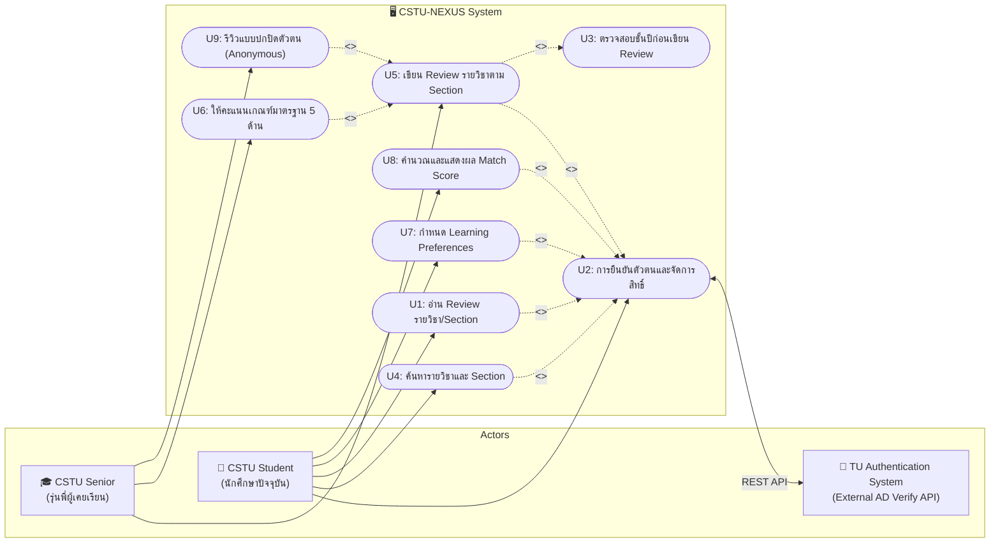

# CSTU-NEXUS — Detailed Use Case Specifications

เอกสารรวบรวมรายละเอียดข้อกำหนดการใช้งาน (**Use Case Specifications**) ของระบบ **CSTU-NEXUS** ทั้งหมด (U1 ถึง U9) ครอบคลุมทั้ง Sprint 1 และ Sprint 2 ตามมาตรฐาน Software Engineering

---

## สารบัญ Use Cases
- [Use Case Overview Diagram](#use-case-overview-diagram)
- [U1: อ่าน Review รายวิชาและ Section จากรุ่นพี่](#u1-อ่าน-review-รายวิชาและ-section-จากรุ่นพี่)
- [U2: การยืนยันตัวตนและการจัดการสิทธิ์ (Authentication & Authorization)](#u2-การยืนยันตัวตนและการจัดการสิทธิ์-authentication--authorization)
- [U3: ตรวจสอบชั้นปีของนักศึกษาก่อนเขียน Review (Eligibility Verification)](#u3-ตรวจสอบชั้นปีของนักศึกษาก่อนเขียน-review-eligibility-verification)
- [U4: ค้นหารายวิชาที่ต้องการ และ Section (Course & Section Search)](#u4-ค้นหารายวิชาที่ต้องการ-และ-section-course--section-search)
- [U5: เขียน Review รายวิชาตาม Section (Submit Course Review)](#u5-เขียน-review-รายวิชาตาม-section-submit-course-review)
- [U6: ให้คะแนนรายวิชาตามหัวข้อเกณฑ์มาตรฐาน 5 ด้าน (Structured Rating)](#u6-ให้คะแนนรายวิชาตามหัวข้อเกณฑ์มาตรฐาน-5-ด้าน-structured-rating)
- [U7: กำหนด Preferences ในการเรียนและระดับ Workload (Learning Preferences)](#u7-กำหนด-preferences-ในการเรียนและระดับ-workload-learning-preferences)
- [U8: คำนวณและแสดงผลความเข้ากันได้รายบุคคล (Match Score Calculation & Exploration)](#u8-คำนวณและแสดงผลความเข้ากันได้รายบุคคล-match-score-calculation--exploration)
- [U9: เขียนและแสดงผลรีวิวแบบปกปิดตัวตน (Anonymous Review & Privacy Masking)](#u9-เขียนและแสดงผลรีวิวแบบปกปิดตัวตน-anonymous-review--privacy-masking)
- [Traceability Matrix (Use Case ↔ User Story ↔ API ↔ UI)](#traceability-matrix)

---

## Use Case Overview Diagram

---

## U1: อ่าน Review รายวิชาและ Section จากรุ่นพี่

| ข้อมูลจำเพาะ | รายละเอียด |
|---|---|
| **Use Case ID** | **U1** |
| **ชื่อ Use Case** | อ่าน Review รายวิชาและ Section จากรุ่นพี่ |
| **Primary Actor** | CSTU Student |
| **Preconditions** | ผู้ใช้เข้าสู่ระบบสำเร็จ (U2) และเปิดอยู่ที่หน้ารายละเอียดรายวิชา (`course-detail.html`) |
| **Trigger** | ผู้ใช้เปิดหน้ารายละเอียดวิชา หรือเลือกเซกชันที่ต้องการกรองรีวิว |
| **Main Success Scenario** | 1. ผู้ใช้เลือกดูรีวิวของรายวิชา 2. ระบบส่งคำขอ `GET /api/courses/{id}/reviews` 3. ระบบอ่านข้อมูลรีวิวจากฐานข้อมูล โดยเรียงลำดับจากรีวิวล่าสุดไปเก่าสุด 4. ระบบแสดงรายการรีวิว ประกอบด้วย: ข้อความรีวิว, ชั้นปีของผู้รีวิว ณ วันที่บันทึก, วันที่เขียน, และคะแนนเกณฑ์มาตรฐาน (U6) 5. กรณีผู้ใช้เลือกตัวกรองเซกชัน ระบบส่งคำขอพร้อม `?sectionId={sectionId}` และแสดงเฉพาะรีวิวของเซกชันนั้น |
| **Alternative Flows** | **3a. รายวิชาหรือเซกชันนั้นยังไม่มีรีวิว:** - ระบบแสดงสถานะ "ยังไม่มีรีวิวสำหรับวิชา/เซกชันนี้" เพื่อแจ้งให้ผู้ใช้ทราบ |
| **Postconditions** | ผู้ใช้ได้รับข้อมูลรีวิวและประสบการณ์จากรุ่นพี่เพื่อนำไปประกอบการตัดสินใจลงทะเบียน |

---

## U2: การยืนยันตัวตนและการจัดการสิทธิ์ (Authentication & Authorization)

| ข้อมูลจำเพาะ | รายละเอียด |
|---|---|
| **Use Case ID** | **U2** |
| **ชื่อ Use Case** | การยืนยันตัวตนและการจัดการสิทธิ์ก่อนใช้งานระบบ |
| **Primary Actor** | CSTU Student |
| **Secondary Actor** | TU AD Verify API |
| **Preconditions** | ผู้ใช้อยู่ที่หน้าเข้าสู่ระบบ (`index.html`) และมีบัญชีนักศึกษามหาวิทยาลัยธรรมศาสตร์ |
| **Trigger** | ผู้ใช้กรอกเลขทะเบียนนักศึกษาและรหัสผ่าน แล้วกดปุ่ม "เข้าสู่ระบบ" |
| **Main Success Scenario** | 1. ผู้ใช้กรอกเลขทะเบียนนักศึกษา 10 หลักและรหัสผ่าน 2. Frontend ส่งคำขอ `POST /api/auth/login` ไปยัง Backend 3. Backend ส่งข้อมูลไปยัง TU AD Verify API พร้อม Application Key ผ่าน HTTPS 4. TU AD Verify API ตอบกลับว่ายืนยันตัวตนถูกต้อง พร้อมส่งข้อมูลผู้ใช้กลับมา 5. Backend ตรวจสอบสถานะการเป็นนักศึกษา และรหัสสาขาว่าสังกัด CSTU (ขึ้นต้นด้วย 6609, 6709, 6809, 6909) 6. Backend คำนวณชั้นปีปัจจุบันอัตโนมัติจากรหัสนักศึกษาเทียบกับปีปัจจุบัน 7. Backend สร้าง HttpOnly Session Cookie (`JSESSIONID`) และส่งกลับให้ Browser 8. Frontend นำทางผู้ใช้ไปยังหน้ารายการวิชา (`courses.html`) |
| **Alternative Flows** | **4a. เลขทะเบียนหรือรหัสผ่านไม่ถูกต้อง:** - TU API ตอบกลับว่าไม่ผ่าน Backend ส่งรหัส HTTP 401 และ Frontend แสดงข้อความแจ้งเตือน "เลขทะเบียนหรือรหัสผ่านไม่ถูกต้อง" **5a. ไม่ใช่นักศึกษาสาขาวิทยาการคอมพิวเตอร์ (CSTU):** - Backend ปฏิเสธการเข้าถึงด้วย HTTP 403 Forbidden และ Frontend แสดงข้อความแจ้งเตือนว่าระบบเปิดให้เฉพาะนักศึกษา CSTU |
| **Postconditions** | ผู้ใช้มี Session การเข้าสู่ระบบที่ปลอดภัย และสามารถเข้าถึงฟังก์ชันต่างๆ ของระบบได้ |

---

## U3: ตรวจสอบชั้นปีของนักศึกษาก่อนเขียน Review (Eligibility Verification)

| ข้อมูลจำเพาะ | รายละเอียด |
|---|---|
| **Use Case ID** | **U3** |
| **ชื่อ Use Case** | ตรวจสอบชั้นปีของนักศึกษาก่อนเขียน Review |
| **Primary Actor** | CSTU Student / CSTU Senior |
| **Preconditions** | ผู้ใช้ผ่านการเข้าสู่ระบบแล้ว (U2) และเปิดดูหน้ารายละเอียดรายวิชา |
| **Trigger** | ระบบโหลดหน้ารายละเอียดรายวิชา หรือผู้ใช้พยายามกดปุ่ม "เขียนรีวิว" |
| **Main Success Scenario** | 1. Frontend ส่งคำขอ `GET /api/courses/{id}/reviews/eligibility` 2. Backend ดึงรหัสนักศึกษาและชั้นปีของผู้ใช้จาก Session 3. Backend ตรวจสอบเงื่อนไขทางธุรกิจ (Business Rules):    - นักศึกษาต้องมีชั้นปีปัจจุบันสูงกว่าชั้นปีที่แนะนำของรายวิชา (`currentYear > recommendedYear`)    - นักศึกษาต้องยังไม่เคยส่งรีวิวรายวิชานี้มาก่อนในระบบ 4. เมื่อผ่านเงื่อนไข Backend ตอบกลับ `{ "eligible": true }` 5. Frontend แสดงปุ่ม "เขียนรีวิว" ในสถานะเปิดใช้งาน (Active) |
| **Alternative Flows** | **3a. ชั้นปียังไม่ถึงเกณฑ์ที่กำหนด (เช่น อยู่ปี 1 แต่อยากรีวิววิชาปี 1 หรือ 2):** - Backend ตอบกลับ `{ "eligible": false, "reason": "YEAR_NOT_ELIGIBLE" }` - Frontend แสดงปุ่มเขียนรีวิวในสถานะปิดใช้งาน (Disabled) พร้อม tooltip หรือข้อความอธิบายเหตุผล **3b. ผู้ใช้เคยรีวิววิชานี้ไปแล้ว:** - Backend ตอบกลับ `{ "eligible": false, "reason": "ALREADY_REVIEWED" }` - Frontend เปลี่ยนปุ่มเป็น "แก้ไขรีวิวของฉัน" หรือแจ้งว่าได้รีวิวไปแล้ว |
| **Postconditions** | ผู้ใช้ที่ผ่านเกณฑ์เท่านั้นที่จะสามารถเข้าสู่หน้าฟอร์มเขียนรีวิว (U5) ได้ |

---

## U4: ค้นหารายวิชาที่ต้องการ และ Section (Course & Section Search)

| ข้อมูลจำเพาะ | รายละเอียด |
|---|---|
| **Use Case ID** | **U4** |
| **ชื่อ Use Case** | ค้นหารายวิชาที่ต้องการ และ Section |
| **Primary Actor** | CSTU Student |
| **Preconditions** | ผู้ใช้เข้าสู่ระบบสำเร็จ (U2) และเปิดหน้า `courses.html` |
| **Trigger** | ผู้ใช้พิมพ์คำค้นหา หรือเลือกตัวกรองชั้นปี หรือคลิกเลือกรายวิชา |
| **Main Success Scenario** | 1. ผู้ใช้ระบุคำค้นหา (รหัสวิชา เช่น `CS261` หรือชื่อวิชา) และ/หรือเลือกชั้นปี (ปี 1–4) 2. Frontend ส่งคำขอ `GET /api/courses?keyword={keyword}&year={year}` 3. Backend สั่งค้นหาข้อมูลจากตาราง `courses` แบบ Partial Match (ILIKE) และกรองชั้นปี 4. Backend ส่งรายการรายวิชากลับมาในรูปแบบ JSON List 5. Frontend แสดงผลการ์ดรายวิชาทั้งหมดที่ตรงตามเงื่อนไข พร้อมแสดงรหัสวิชา ชื่อวิชา และชั้นปีแนะนำ 6. เมื่อผู้ใช้คลิกเลือกรายวิชา ระบบนำทางไปยัง `course-detail.html?courseId={id}` และดึงข้อมูลเซกชันพร้อมอาจารย์ผู้สอน |
| **Alternative Flows** | **4a. ไม่พบรายวิชาที่ตรงตามเงื่อนไข:** - Frontend แสดงภาพหรือข้อความ "ไม่พบรายวิชาที่ตรงกับคำค้นหาของคุณ" และแนะนำให้ลองใช้คำค้นหาอื่น |
| **Postconditions** | ผู้ใช้พบรายวิชาและข้อมูลเซกชันที่ต้องการศึกษา |

---

## U5: เขียน Review รายวิชาตาม Section (Submit Course Review)

| ข้อมูลจำเพาะ | รายละเอียด |
|---|---|
| **Use Case ID** | **U5** |
| **ชื่อ Use Case** | เขียน Review รายวิชาตาม Section |
| **Primary Actor** | CSTU Senior |
| **Preconditions** | ผู้ใช้เข้าสู่ระบบแล้ว (U2) และผ่านการตรวจสอบสิทธิ์ชั้นปีเรียบร้อยแล้ว (U3) |
| **Trigger** | ผู้ใช้กดปุ่ม "เขียนรีวิว" และเข้าสู่หน้า `write-review.html` |
| **Main Success Scenario** | 1. ผู้ใช้เลือกเซกชันที่ตนเองเคยเรียน และกรอกข้อความรีวิวประสบการณ์การเรียน 2. ผู้ใช้กดปุ่ม "ส่งรีวิว" 3. Frontend ตรวจสอบความถูกต้องของฟอร์ม (Validation: มีข้อความรีวิว และเลือกเซกชัน) 4. Frontend ส่งคำขอ `POST /api/courses/{id}/reviews` พร้อมแนบ Payload ข้อความรีวิว 5. Backend ตรวจสอบสิทธิ์ชั้นปีซ้ำอีกครั้งที่เซิร์ฟเวอร์ (Server-side Enforcement) 6. Backend ดึง `studentId` และชั้นปีจาก Session บันทึกลงตาราง `review` 7. Backend ส่งรหัสสถานะ HTTP 201 Created 8. Frontend แสดงกล่องข้อความยืนยันความสำเร็จ และนำทางกลับไปยังหน้ารายละเอียดรายวิชา |
| **Alternative Flows** | **3a. ผู้ใช้ไม่ได้กรอกข้อความรีวิว:** - Frontend แสดงข้อความแจ้งเตือนสีแดงใต้กล่องข้อความ และไม่อนุญาตให้กดส่ง **5a. การตรวจสอบที่เซิร์ฟเวอร์พบว่าผู้ใช้ไม่มีสิทธิ์:** - Backend ปฏิเสธคำขอด้วย HTTP 403 Forbidden และ Frontend แสดงหน้าต่างแจ้งเตือนข้อผิดพลาด |
| **Postconditions** | ข้อมูลรีวิวถูกบันทึกลงสู่ฐานข้อมูลอย่างสมบูรณ์ และพร้อมแสดงผลในหน้ารายการรีวิว (U1) |

---

## U6: ให้คะแนนรายวิชาตามหัวข้อเกณฑ์มาตรฐาน 5 ด้าน (Structured Rating)

| ข้อมูลจำเพาะ | รายละเอียด |
|---|---|
| **Use Case ID** | **U6** |
| **ชื่อ Use Case** | ให้คะแนนรายวิชาตามหัวข้อเกณฑ์มาตรฐาน 5 ด้าน |
| **Primary Actor** | CSTU Senior |
| **Preconditions** | ผู้ใช้อยู่ในหน้าเขียนรีวิว (`write-review.html`) ของรายวิชาที่ตนมีสิทธิ์ (U3) |
| **Trigger** | ผู้ใช้เลือกระดับคะแนนเกณฑ์มาตรฐาน 5 ด้านในฟอร์มรีวิว |
| **Main Success Scenario** | 1. ผู้ใช้เลือกประเมินคะแนนเกณฑ์มาตรฐาน 5 ด้าน ได้แก่:    - แนวการสอน (เน้นทฤษฎี 0 / สมดุล 50 / เน้นปฏิบัติ 100)    - สัดส่วนคะแนน (เน้นสอบ 0 / สมดุล 50 / เน้นโครงงาน 100)    - ความเร็วการสอน (สอนช้า 0 / ปานกลาง 50 / สอนเร็ว 100)    - รูปแบบงาน (งานเดี่ยว 0 / สมดุล 50 / งานกลุ่ม 100)    - ปริมาณงาน / Workload (งานน้อย 0 / ปานกลาง 50 / งานมาก 100) 2. เมื่อกดส่งรีวิว Frontend ส่งคะแนนทั้ง 5 ด้านไปพร้อมกับ Payload รีวิว (U5) 3. Backend บันทึกคะแนนลงในตาราง `review` เพื่อใช้เป็นฐานข้อมูลสถิติสำหรับ U8 |
| **Alternative Flows** | **1a. ผู้ใช้ไม่ประสงค์จะให้คะแนนบางหัวข้อ:** - ระบบอนุญาตให้ส่งค่า `null` ในหัวข้อที่ไม่ได้เลือก โดยยังคงบันทึกข้อความรีวิวและหัวข้อที่เลือกได้ตามปกติ |
| **Postconditions** | ระบบมีข้อมูลคะแนนเชิงปริมาณสำหรับนำไปสร้าง Section Profile และคำนวณ Match Score (U8) |

---

## U7: กำหนด Preferences ในการเรียนและระดับ Workload (Learning Preferences)

| ข้อมูลจำเพาะ | รายละเอียด |
|---|---|
| **Use Case ID** | **U7** |
| **ชื่อ Use Case** | กำหนด Preferences ในการเรียนและระดับ Workload |
| **Primary Actor** | CSTU Student |
| **Preconditions** | ผู้ใช้เข้าสู่ระบบสำเร็จ (U2) |
| **Trigger** | ผู้ใช้เปิดหน้า Preferences (`preference.html`) |
| **Main Success Scenario** | 1. ผู้ใช้เปิดหน้า `preference.html` ระบบดึงค่าเดิมที่เคยบันทึกไว้ผ่าน `GET /api/users/preferences` 2. หน้าเว็บแสดงการเลือกเดิม (ถ้ามี) หรือแสดงสถานะยังไม่ได้เลือก 3. ผู้ใช้ปรับค่าความชอบในการเรียน 5 ด้าน (แนวการสอน, สัดส่วนคะแนน, ความเร็ว, รูปแบบงาน, ระดับ Workload ที่รับได้) 4. ผู้ใช้กดปุ่ม "บันทึก Preferences" 5. Frontend ส่งคำขอ `PUT /api/users/preferences` พร้อม Payload JSON 6. Backend ทำการ Upsert ข้อมูลลงตาราง `user_preferences` ของผู้ใช้นั้น 7. Backend ส่งรหัส HTTP 200 OK พร้อมข้อมูลที่บันทึก 8. Frontend แสดงกล่องข้อความยืนยันการบันทึกสำเร็จ |
| **Alternative Flows** | **5a. ผู้ใช้ไม่ระบุค่า Workload:** - Frontend แจ้งเตือนให้เลือกค่า Workload ก่อนบันทึก |
| **Postconditions** | ข้อมูลความชอบในการเรียนของผู้ใช้ถูกบันทึกเพื่อนำไปใช้คำนวณ Match Score ใน U8 |

---

## U8: คำนวณและแสดงผลความเข้ากันได้รายบุคคล (Match Score Calculation & Exploration)

| ข้อมูลจำเพาะ | รายละเอียด |
|---|---|
| **Use Case ID** | **U8** |
| **ชื่อ Use Case** | คำนวณและแสดงผลความเข้ากันได้รายบุคคล (Match Score Calculation & Exploration) |
| **Primary Actor** | CSTU Student |
| **Preconditions** | ผู้ใช้เข้าสู่ระบบสำเร็จ (U2) และเปิดดูหน้ารายละเอียดรายวิชา (`course-detail.html`) |
| **Trigger** | ผู้ใช้เปิดดูเซกชันของรายวิชา |
| **Main Success Scenario** | 1. Frontend ส่งคำขอ `GET /api/courses/{id}/sections/{secId}/match-score` 2. Backend ดึงค่า Preferences ของผู้ใช้จาก Session/DB (U7) และดึงสถิติคะแนนรีวิวของเซกชันนั้น (U6) 3. Backend ประมวลผล 2 รอบ:    - รอบที่ 1 (Section Profile): หาค่าคะแนนที่เป็นฉันทามติ (Consensus) จากคะแนนโหวตส่วนใหญ่ของแต่ละด้าน    - รอบที่ 2 (Similarity): เปรียบเทียบความเข้ากันได้ระหว่าง Preference กับ Section Profile (4 ด้านแรกใช้ `100 - abs(pref - sec)` ส่วน Workload ใช้ `100 - max(0, sec - tolerance)`) 4. Backend รวมคะแนนเฉลี่ยเป็นเปอร์เซ็นต์ (0–100%) พร้อมจัดระดับ (เช่น "เข้ากันได้ดีมาก", "เข้ากันได้ดี") และส่งคำอธิบายกลับมา 5. Frontend แสดงแถบ Progress Bar เปอร์เซ็นต์ความเข้ากันได้ของแต่ละเซกชันเพื่อช่วยผู้ใช้ตัดสินใจ |
| **Alternative Flows** | **2a. ผู้ใช้ยังไม่เคยตั้งค่า Preferences หรือเซกชันนั้นยังไม่มีข้อมูลรีวิวเพียงพอ:** - Backend ตอบกลับสถานะ `NO_DATA` - Frontend แสดงข้อความ "ยังไม่มีข้อมูลเพียงพอสำหรับคำนวณ Match Score" เพื่อความโปร่งใสทางสถิติ |
| **Postconditions** | ผู้ใช้ทราบระดับความเข้ากันได้เชิงวิเคราะห์ระหว่างสไตล์การเรียนของตนเองกับแต่ละเซกชัน |

---

## U9: เขียนและแสดงผลรีวิวแบบปกปิดตัวตน (Anonymous Review & Privacy Masking)

| ข้อมูลจำเพาะ | รายละเอียด |
|---|---|
| **Use Case ID** | **U9** |
| **ชื่อ Use Case** | เขียนและแสดงผลรีวิวแบบปกปิดตัวตน (Anonymous Review & Privacy Masking) |
| **Primary Actor** | CSTU Senior (ผู้เขียนรีวิว), CSTU Student (ผู้อ่านรีวิว) |
| **Preconditions** | ผู้ใช้อยู่ในหน้าเขียนรีวิว (`write-review.html`) ของรายวิชาที่มีสิทธิ์ (U3) หรือเปิดอ่านรีวิว (U1) |
| **Trigger** | ผู้ใช้เปิดสวิตช์ "ไม่เปิดเผยตัวตน (Anonymous)" ขณะเขียนรีวิว หรือผู้ใช้เปิดอ่านหน้ารายการรีวิว |
| **Main Success Scenario** | **ส่วนที่ 1: การเขียนรีวิวแบบปกปิดตัวตน** 1. ผู้ใช้เปิดสวิตช์ Toggle "ไม่เปิดเผยตัวตน" 2. เมื่อกดส่งรีวิว Frontend ส่งค่า `isAnonymous: true` แนบไปกับ Payload ของคำขอ `POST /api/courses/{id}/reviews` 3. Backend บันทึกค่า `is_anonymous = true` ลงตาราง `review` โดยยังคงบันทึก `user_id` จริงไว้ภายในเพื่อตรวจสอบสิทธิ์และการแก้ไข  **ส่วนที่ 2: การอ่านและพรางข้อมูลผู้รีวิว (Masking)** 4. เมื่อนักศึกษาคนอื่นเรียกดูรีวิว (`GET /api/courses/{id}/reviews`) 5. Backend ตรวจสอบหากรีวิวใดมี `is_anonymous = true` ระบบจะทำการ Mask รหัสนักศึกษาเหลือเฉพาะรหัสรุ่น (เช่น `68********`) และไม่ส่ง `userId` หรือ `studentId` จริงออกมาใน Response 6. Frontend แสดงชื่อผู้เขียนเป็นรหัสรุ่นพรางตัว พร้อมป้ายกำกับ "รีวิวนิรนาม" |
| **Alternative Flows** | **3a. เจ้าของรีวิวต้องการแก้ไขรีวิวของตนเอง:** - เจ้าของรีวิวยังคงสามารถกดแก้ไขข้อความหรือเปลี่ยนสถานะ Anonymous ผ่าน `PUT /api/courses/{id}/reviews/{reviewId}` ได้ โดยระบบตรวจสอบความเป็นเจ้าของจาก Session |
| **Postconditions** | รีวิวถูกเผยแพร่โดยปกป้องความเป็นส่วนตัวของผู้เขียน และนักศึกษารุ่นน้องได้ข้อมูลที่เป็นความจริงอย่างตรงไปตรงมา |

---

## Traceability Matrix

| Use Case ID | ชื่อ Use Case | Sprint | User Story ID | API Endpoint ที่เกี่ยวข้อง | หน้าเว็บ UI |
|:---:|---|:---:|:---:|---|---|
| **U1** | อ่าน Review รายวิชาและ Section จากรุ่นพี่ | 1 | **US-04** | `GET /api/courses/{id}/reviews` | `course-detail.html` |
| **U2** | การยืนยันตัวตนและการจัดการสิทธิ์ | 1 | **US-01** | `POST /api/auth/login` `GET /api/auth/me` `POST /api/auth/logout` | `index.html` `profile.html` |
| **U3** | ตรวจสอบชั้นปีก่อนเขียน Review | 1 | **US-05** | `GET /api/courses/{id}/reviews/eligibility` | `course-detail.html` `write-review.html` |
| **U4** | ค้นหารายวิชาที่ต้องการ และ Section | 1 | **US-02, US-03** | `GET /api/courses?keyword=&year=` `GET /api/courses/{id}` | `courses.html` `course-detail.html` |
| **U5** | เขียน Review รายวิชาตาม Section | 1 | **US-05** | `POST /api/courses/{id}/reviews` | `write-review.html` |
| **U6** | ให้คะแนนรายวิชาตามหัวข้อเกณฑ์ 5 ด้าน | 2 | **US-06** | `POST /api/courses/{id}/reviews` | `write-review.html` |
| **U7** | กำหนด Preferences ในการเรียนและ Workload | 2 | **US-07** | `GET /api/users/preferences` `PUT /api/users/preferences` | `preference.html` |
| **U8** | คำนวณและแสดงผล Match Score รายบุคคล | 2 | **US-08** | `GET /api/courses/{id}/sections/{secId}/match-score` | `course-detail.html` |
| **U9** | รีวิวแบบปกปิดตัวตน (Anonymous) | 2 | **US-09** | `POST /api/courses/{id}/reviews` `PUT /api/courses/{id}/reviews/{id}` | `write-review.html` `course-detail.html` |
