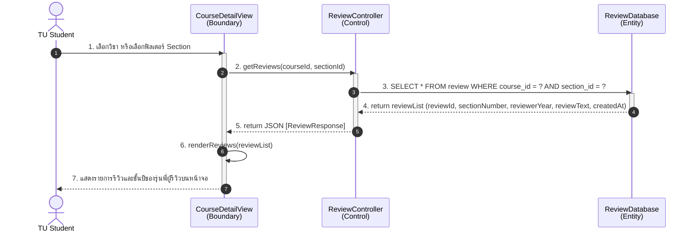
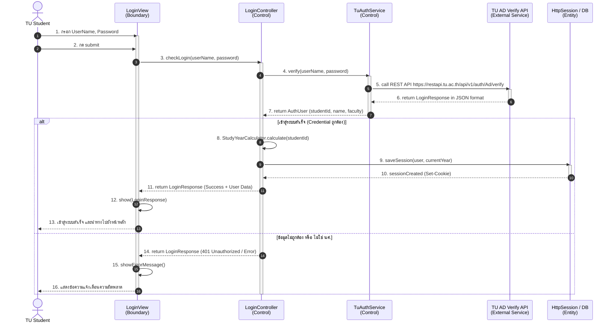
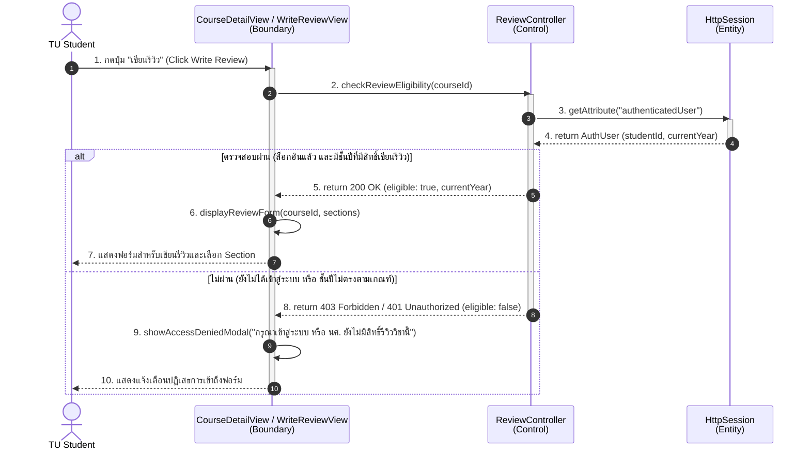
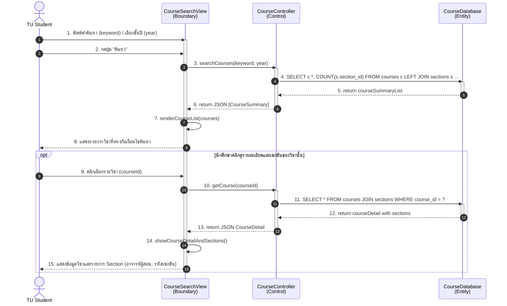
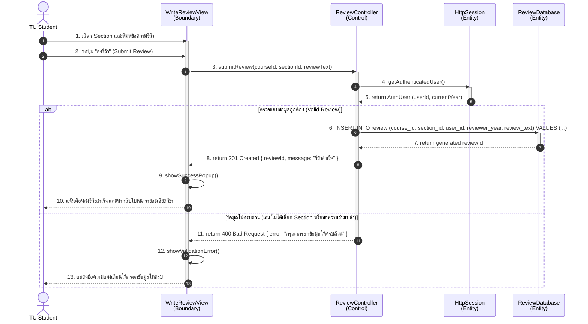

# CSTU-NEXUS - Sequence Diagrams

เอกสารรวบรวม Sequence Diagrams สำหรับระบบ **CSTU-NEXUS** ในรูปแบบ **Boundary-Control-Entity (BCE)** อ้างอิงตาม REST API และกระบวนการทำงานจริงของระบบ (GitHub รองรับการเรนเดอร์ Mermaid Diagrams ด้านล่างโดยอัตโนมัติ)

---

## สารบัญ Use Cases
- [U1: อ่าน Review ของรายวิชาและ Section จากรุ่นพี่](#u1-อ่าน-review-ของรายวิชาและ-section-จากรุ่นพี่)
- [U2: การยืนยันตัวตนและการจัดการสิทธิ์ก่อนใช้งานระบบ (Authentication & Authorization)](#u2-การยืนยันตัวตนและการจัดการสิทธิ์ก่อนใช้งานระบบ-authentication--authorization)
- [U3: ตรวจสอบชั้นปีของนักศึกษาก่อนเขียน Review](#u3-ตรวจสอบชั้นปีของนักศึกษาก่อนเขียน-review)
- [U4: ค้นหารายวิชาที่ต้องการ และ Section](#u4-ค้นหารายวิชาที่ต้องการ-และ-section)
- [U5: เขียน Review รายวิชาตาม Section](#u5-เขียน-review-รายวิชาตาม-section)

---

## U1: อ่าน Review ของรายวิชาและ Section จากรุ่นพี่

- **Endpoint:** `GET /api/courses/{id}/reviews?sectionId=...`
- **คำอธิบาย:** นักศึกษาเปิดหน้ารายละเอียดรายวิชาเพื่ออ่านรีวิวทั้งหมด หรือเลือกกรองเฉพาะ Section ที่ต้องการศึกษา

---

## U2: การยืนยันตัวตนและการจัดการสิทธิ์ก่อนใช้งานระบบ (Authentication & Authorization)

- **Endpoint:** `POST /api/auth/login`
- **คำอธิบาย:** นักศึกษาเข้าสู่ระบบด้วยเลขทะเบียนนักศึกษาและรหัสผ่าน โดยระบบจะทำการยืนยันตัวตนผ่าน TU AD Verify API คำนวณชั้นปี และสร้าง Session

---

## U3: ตรวจสอบชั้นปีของนักศึกษาก่อนเขียน Review

- **Endpoint:** `GET /api/auth/me`
- **คำอธิบาย:** ตรวจสอบว่าผู้ใช้ล็อกอินอยู่หรือไม่ และมีชั้นปีที่มีสิทธิ์เขียนรีวิวหรือไม่ก่อนเปิดฟอร์มเขียนรีวิว

---

## U4: ค้นหารายวิชาที่ต้องการ และ Section

- **Endpoint:** `GET /api/courses?keyword=...&year=...` และ `GET /api/courses/{id}`
- **คำอธิบาย:** ค้นหารายวิชาตามคีย์เวิร์ดหรือชั้นปีที่แนะนำ และกดเข้าไปดูข้อมูลเซกชันและอาจารย์ผู้สอน

---

## U5: เขียน Review รายวิชาตาม Section

- **Endpoint:** `POST /api/courses/{id}/reviews`
- **คำอธิบาย:** นักศึกษากรอกเนื้อหารีวิว เลือกเซกชัน และบันทึกข้อมูลลงฐานข้อมูล

