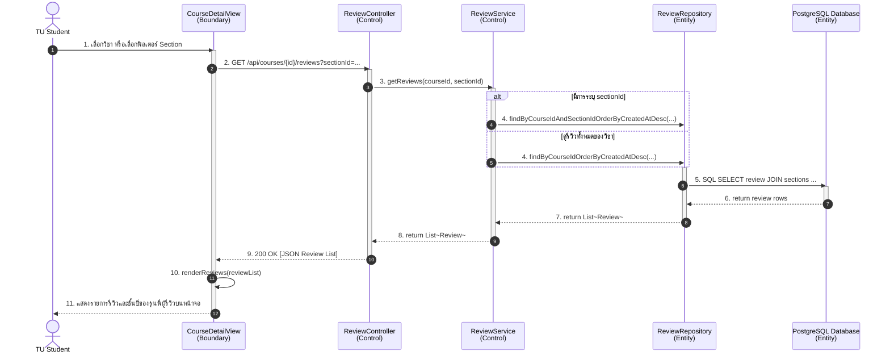
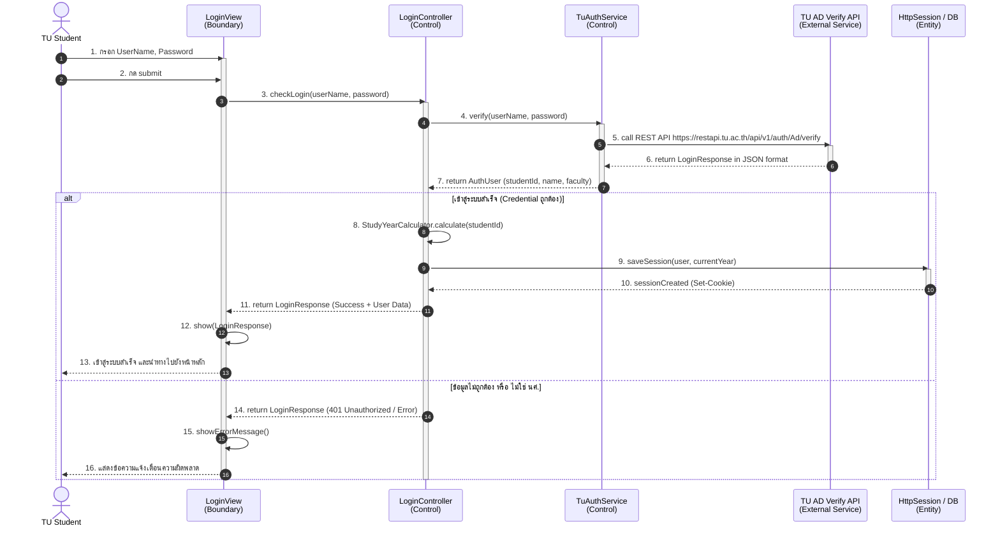
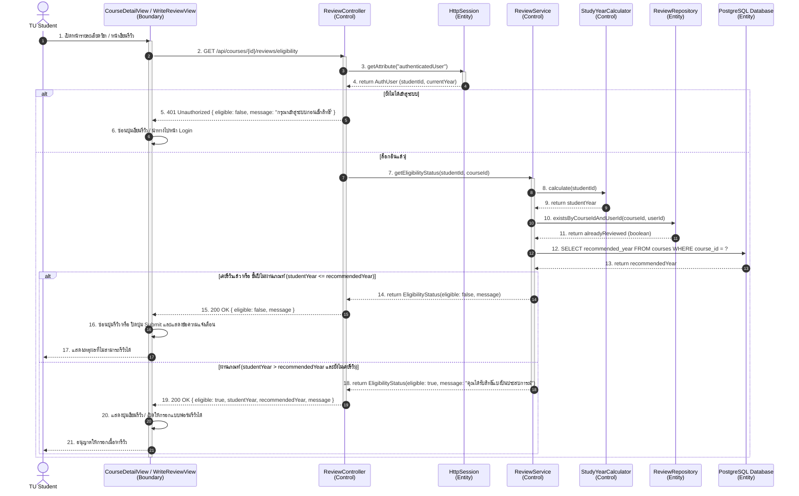
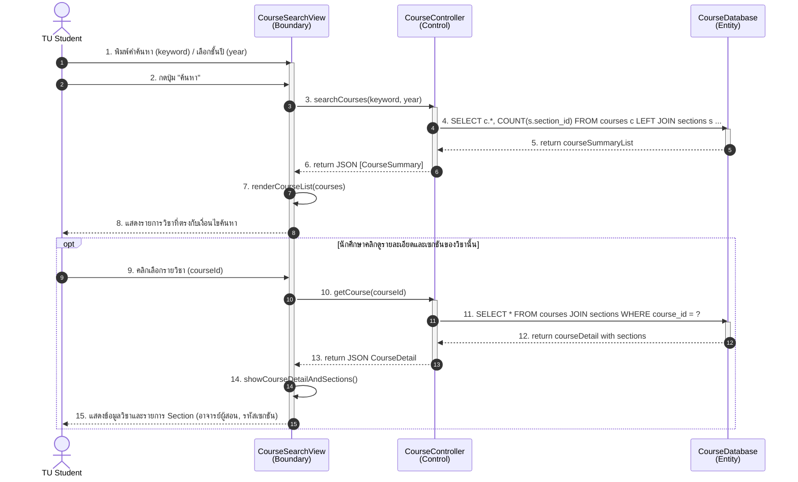
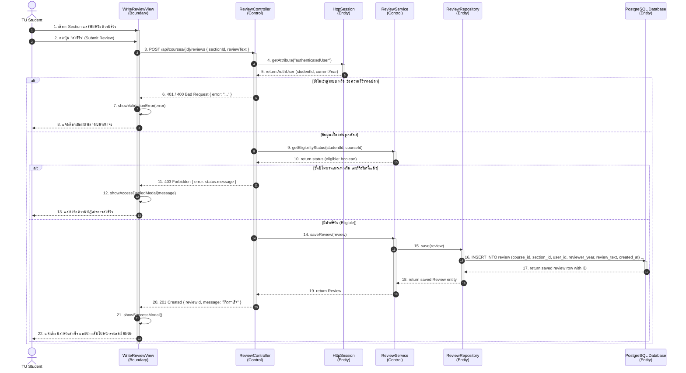
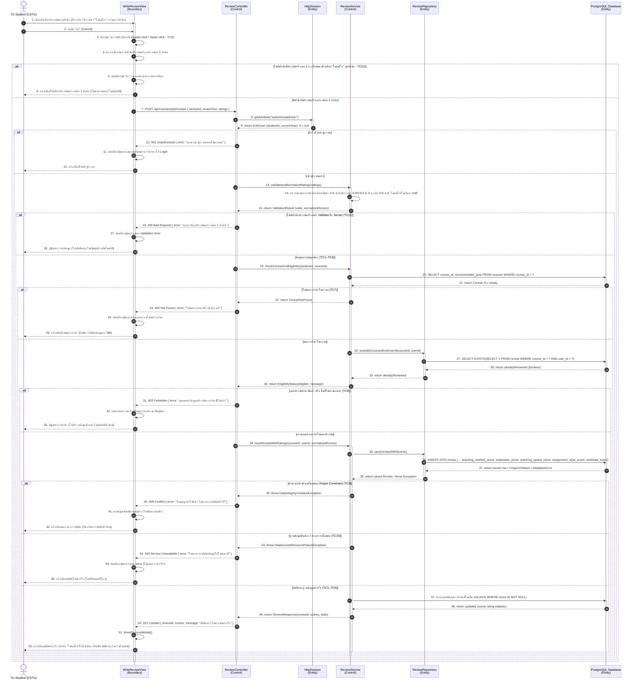

# CSTU-NEXUS - Sequence Diagrams

เอกสารรวบรวม Sequence Diagrams สำหรับระบบ **CSTU-NEXUS** ในรูปแบบ **Boundary-Control-Entity (BCE)** อ้างอิงตาม REST API และกระบวนการทำงานจริงของระบบ (GitHub รองรับการเรนเดอร์ Mermaid Diagrams ด้านล่างโดยอัตโนมัติ)

---

## สารบัญ Use Cases

### Sprint 1
- [U1: อ่าน Review ของรายวิชาและ Section จากรุ่นพี่](#u1-อ่าน-review-ของรายวิชาและ-section-จากรุ่นพี่)
- [U2: การยืนยันตัวตนและการจัดการสิทธิ์ก่อนใช้งานระบบ (Authentication & Authorization)](#u2-การยืนยันตัวตนและการจัดการสิทธิ์ก่อนใช้งานระบบ-authentication--authorization)
- [U3: ตรวจสอบชั้นปีของนักศึกษาก่อนเขียน Review](#u3-ตรวจสอบชั้นปีของนักศึกษาก่อนเขียน-review)
- [U4: ค้นหารายวิชาที่ต้องการ และ Section](#u4-ค้นหารายวิชาที่ต้องการ-และ-section)
- [U5: เขียน Review รายวิชาตาม Section](#u5-เขียน-review-รายวิชาตาม-section)

### Sprint 2
- [U6: ให้คะแนนรายวิชาตามหัวข้อที่กำหนด](#u6-ให้คะแนนรายวิชาตามหัวข้อที่กำหนด)

---

## Sprint 1 (U1–U5)

### U1: อ่าน Review ของรายวิชาและ Section จากรุ่นพี่

- **Endpoint:** `GET /api/courses/{id}/reviews?sectionId=...`
- **คำอธิบาย:** นักศึกษาเปิดหน้ารายละเอียดรายวิชาเพื่ออ่านรีวิวทั้งหมด หรือเลือกกรองเฉพาะ Section ที่ต้องการศึกษา

---

### U2: การยืนยันตัวตนและการจัดการสิทธิ์ก่อนใช้งานระบบ (Authentication & Authorization)

- **Endpoint:** `POST /api/auth/login`
- **คำอธิบาย:** นักศึกษาเข้าสู่ระบบด้วยเลขทะเบียนนักศึกษาและรหัสผ่าน โดยระบบจะทำการยืนยันตัวตนผ่าน TU AD Verify API คำนวณชั้นปี และสร้าง Session

---

### U3: ตรวจสอบชั้นปีของนักศึกษาก่อนเขียน Review

- **Endpoint:** `GET /api/courses/{id}/reviews/eligibility`
- **คำอธิบาย:** ระบบตรวจสอบว่าผู้ใช้ได้เข้าสู่ระบบ มีชั้นปีที่ผ่านเกณฑ์ (`studentYear > recommendedYear`) และยังไม่เคยส่งรีวิวในรายวิชานี้มาก่อน

---

### U4: ค้นหารายวิชาที่ต้องการ และ Section

- **Endpoint:** `GET /api/courses?keyword=...&year=...` และ `GET /api/courses/{id}`
- **คำอธิบาย:** ค้นหารายวิชาตามคีย์เวิร์ดหรือชั้นปีที่แนะนำ และกดเข้าไปดูข้อมูลเซกชันและอาจารย์ผู้สอน

---

### U5: เขียน Review รายวิชาตาม Section

- **Endpoint:** `POST /api/courses/{id}/reviews`
- **คำอธิบาย:** นักศึกษากรอกเนื้อหารีวิว เลือกเซกชัน และบันทึกข้อมูลลงฐานข้อมูล

---

## Sprint 2 (U6)

### U6: ให้คะแนนรายวิชาตามหัวข้อที่กำหนด

- **Endpoint:** `POST /api/courses/{id}/reviews`
- **คำอธิบาย:** นักศึกษา CSTU ให้คะแนนประเมินรายวิชาตามหัวข้อมาตรฐานที่กำหนด โดยเลือกประเมินบางหัวข้อหรือเลือก `"ไม่แน่ใจ"` ได้ (ต้องประเมินจริงอย่างน้อย 1 หัวข้อ) ระบบแปลงตัวเลือกเป็นค่าตัวเลข `0.0–1.0` เพื่อจัดเก็บและคำนวณสถิติ พร้อมป้องกันการส่งข้อมูลไปยังวิชาที่ไม่มีอยู่ การส่งซ้ำ และ DB Error

#### เกณฑ์การแปลงคะแนนมาตรฐาน (0.0 – 1.0) และเงื่อนไขสำคัญ (TC1–TC11)
- **หัวข้อแบบ 3 ระดับ** *(แนวทางการสอน, สัดส่วนการวัดผลและตัดเกรด, รูปแบบงาน)*: แปลงเป็น `0.0`, `0.5`, `1.0` ตามลำดับ (TC3, TC5)
- **หัวข้อแบบ 5 ระดับ** *(ความเร็วในการสอน, ปริมาณงาน)*: แปลงเป็น `0.0`, `0.25`, `0.5`, `0.75`, `1.0` ตามลำดับ (TC4, TC5)
- **ตัวเลือก `"ไม่แน่ใจ"` หรือหัวข้อที่ไม่ได้เลือก**: จัดเก็บเป็น `null` และไม่นำไปคำนวณค่าเฉลี่ย/สถิติของหัวข้อนั้น (TC1, TC2)
- **เงื่อนไขป้องกันข้อผิดพลาด (Validation & Reliability)**:
  - ต้องมีหัวข้อที่ประเมินจริงอย่างน้อย 1 หัวข้อ หากว่างทั้งหมดหรือเป็น `"ไม่แน่ใจ"` ทั้งหมดระบบจะปฏิเสธการส่ง (TC11)
  - ตรวจสอบรายวิชาในฐานข้อมูลก่อนบันทึก หากไม่มีรายวิชาจะปฏิเสธและแจ้งเตือน (TC7)
  - ป้องกันการประเมินซ้ำในวิชาเดิม และการกดปุ่มส่งรัวๆ (Double-click / Spam click) ทั้งฝั่ง UI Lock และ Unique Constraint `(course_id, user_id)` (TC8, TC9)
  - กรณีฐานข้อมูลขัดข้อง ระบบจะคืนข้อผิดพลาดโดยไม่แสดงว่าสำเร็จและไม่อัปเดตสถิติใดๆ (TC10)

