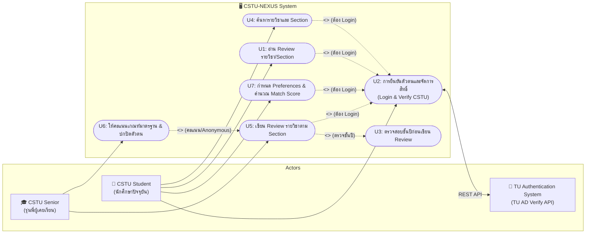

# CSTU-NEXUS — Use Case & Class Diagrams

เอกสารรวบรวม **Use Case Diagram** และ **Design Class Diagram** สำหรับระบบ **CSTU-NEXUS** อ้างอิงตามขอบเขตงาน Sprint 1 (U1–U5) และ Sprint 2 (U6–U7) ตามสถาปัตยกรรมแบบ **Boundary-Control-Entity (BCE) / Layered Pattern**

> 📖 **เอกสารที่เกี่ยวข้อง:**
> - [Detailed Use Case Specifications](use-cases.md) — ข้อกำหนดรายละเอียด Use Cases ทุกข้อ (Preconditions, Flow, Postconditions)
> - [User Stories](user-stories.md) — ข้อกำหนดความต้องการในรูปแบบ Agile User Stories (Persona, Want, Value, Acceptance Criteria)
> - [System Architecture](architecture.md) — สถาปัตยกรรมระบบ การแบ่งเลเยอร์ ความปลอดภัย และการติดตั้งระบบ
> - [Sequence Diagrams](sequence-diagrams.md) — แผนภาพลำดับการทำงาน U1–U7

---

## สารบัญ
1. [Use Case Diagram & Summary (U1–U7)](#1-use-case-diagram--summary-u1u7)
2. [Design Class Diagram (BCE Pattern)](#2-design-class-diagram-bce-pattern)
3. [System Architecture Reference](#3-system-architecture-reference)

---

## 1. Use Case Diagram & Summary (U1–U7)

### 1.1 Use Case Diagram (CSTU-NEXUS)

### 1.2 ตารางสรุป Use Cases (U1–U7)

| Use Case ID | ชื่อ Use Case | Sprint | Actor หลัก | ความสัมพันธ์ | วัตถุประสงค์โดยสรุป |
|:---:|---|:---:|:---:|:---:|---|
| **U1** | อ่าน Review รายวิชาและ Section จากรุ่นพี่ | 1 | CSTU Student | `<<include>> U2` | เปิดดูประวัติรีวิวและคำแนะนำของแต่ละเซกชันจากรุ่นพี่ในหลักสูตร |
| **U2** | การยืนยันตัวตนและการจัดการสิทธิ์ | 1 | CSTU Student, TU AD Verify API | - | ตรวจสอบรหัสนักศึกษาและรหัสผ่านผ่านระบบของมหาวิทยาลัย และคัดกรองเฉพาะ นศ. CSTU |
| **U3** | ตรวจสอบชั้นปีก่อนเขียน Review | 1 | CSTU Senior | `<<included by>> U5` | ตรวจสอบว่าผู้ใช้มีชั้นปี > ชั้นปีที่แนะนำ (`recommended_year`) และยังไม่เคยส่งรีวิวรายวิชานี้ |
| **U4** | ค้นหารายวิชาที่ต้องการ และ Section | 1 | CSTU Student | `<<include>> U2` | ค้นหารายวิชาจากรหัส/ชื่อวิชา คัดกรองตามชั้นปี และดูรายชื่อเซกชันพร้อมผู้สอน |
| **U5** | เขียน Review รายวิชาตาม Section | 1 | CSTU Senior | `<<include>> U2, U3` | กรอกข้อความรีวิวประสบการณ์การเรียนและส่งบันทึกแยกตาม Section |
| **U6** | ให้คะแนนเกณฑ์มาตรฐาน & รีวิวแบบปกปิดตัวตน | 2 | CSTU Senior | `<<extend>> U5` | ให้คะแนน 5 ด้านมาตรฐาน (0, 50, 100) และเลือกเปิดโหมดปกปิดตัวตน (Anonymous) |
| **U7** | กำหนด Preferences & คำนวณ Match Score | 2 | CSTU Student | `<<include>> U2` | ตั้งค่าสไตล์การเรียนและ Workload ของตนเอง พร้อมดูความเข้ากันได้ (%) กับแต่ละเซกชัน |

---

## 2. Design Class Diagram (BCE Pattern)

แผนภาพแสดงโครงสร้างคลาสเชิงสถิต (Static Structure) แบ่งตามรูปแบบ **Boundary-Control-Entity (BCE)** ครอบคลุมคอมโพเนนต์หลักของระบบ:

```mermaid
classDiagram
    %% =======================
    %% BOUNDARY LAYER (FRONTEND)
    %% =======================
    class LoginView {
        +submitLogin(username, password)
        +showErrorMessage(message)
        +redirectHome()
    }

    class CourseSearchView {
        -keyword: String
        -selectedYear: Integer
        +searchCourses(keyword, year)
        +renderCourseList(courses)
    }

    class CourseDetailView {
        -currentCourseId: String
        -selectedSectionId: String
        +loadCourseDetail(courseId)
        +displaySections(sections)
        +displayReviews(reviews)
        +loadMatchScore(sectionId)
    }

    class WriteReviewView {
        -courseId: String
        -sectionId: String
        -reviewText: String
        -isAnonymous: Boolean
        -ratings: RatingScores
        +checkEligibility()
        +submitReview()
        +showDeniedModal()
    }

    class PreferenceView {
        -preferences: UserPreferences
        +loadPreferences()
        +savePreferences(preferences)
    }

    %% =======================
    %% CONTROL LAYER (BACKEND)
    %% =======================
    class AuthController {
        -tuAuthService: TuAuthService
        +login(request, servletRequest): LoginResponse
        +currentUser(request): AuthUser
        +logout(request): ResponseEntity
    }

    class TuAuthService {
        -restClient: RestClient
        -verifyUrl: String
        -applicationKey: String
        +verify(username, password): AuthUser
    }

    class StudyYearCalculator {
        +calculate(studentId): Integer
    }

    class CourseController {
        -jdbcTemplate: JdbcTemplate
        +searchCourses(keyword, year): List~CourseSummary~
        +getCourse(courseId): CourseDetail
    }

    class ReviewController {
        -reviewService: ReviewService
        +getReviews(courseId, sectionId): ResponseEntity
        +checkReviewEligibility(courseId, session): ResponseEntity
        +submitReview(courseId, review, session): ResponseEntity
        +updateReview(courseId, reviewId, review, session): ResponseEntity
    }

    class ReviewService {
        -reviewRepository: ReviewRepository
        -jdbcTemplate: JdbcTemplate
        +getReviews(courseId, sectionId): List~Review~
        +checkReviewEligibility(studentId, courseId): boolean
        +getEligibilityStatus(studentId, courseId): EligibilityStatus
        +saveReview(review): Review
    }

    class PreferenceController {
        -preferenceService: PreferenceService
        +getPreferences(session): ResponseEntity
        +savePreferences(request, session): ResponseEntity
    }

    class MatchScoreController {
        -matchScoreService: MatchScoreService
        +getMatchScore(courseId, sectionId, session): ResponseEntity
    }

    class MatchScoreService {
        -matchScoreRepository: MatchScoreRepository
        +calculateScore(studentId, courseId, sectionId): MatchScoreResult
    }

    class ReviewRepository {
        <<interface>>
        +findByCourseIdOrderByCreatedAtDesc(courseId): List~Review~
        +findByCourseIdAndSectionIdOrderByCreatedAtDesc(courseId, sectionId): List~Review~
        +existsByCourseIdAndUserId(courseId, userId): boolean
    }

    %% =======================
    %% ENTITY / MODEL LAYER
    %% =======================
    class AuthUser {
        +displayName: String
        +studentId: String
        +year: Integer
        +faculty: String
        +department: String
        +email: String
    }

    class CourseDetail {
        +courseId: String
        +courseName: String
        +recommendedYear: Integer
        +sections: List~Section~
    }

    class Section {
        +sectionId: String
        +sectionNumber: String
        +instructorName: String
    }

    class Review {
        +id: Long
        +courseId: String
        +sectionId: String
        +userId: Integer
        +reviewerYear: Integer
        +reviewText: String
        +teachingMethodScore: Integer
        +evaluationScore: Integer
        +teachingSpeedScore: Integer
        +assignmentStyleScore: Integer
        +workloadScore: Integer
        +isAnonymous: Boolean
        +createdAt: LocalDateTime
    }

    class UserPreferences {
        +userId: Integer
        +preferredTeachingMethod: Integer
        +preferredEvaluation: Integer
        +preferredTeachingSpeed: Integer
        +preferredAssignmentStyle: Integer
        +preferredWorkload: Integer
    }

    class MatchScoreResult {
        +status: String
        +score: Integer
        +level: String
        +explanation: String
    }

    %% =======================
    %% RELATIONSHIPS
    %% =======================
    LoginView ..> AuthController : HTTP
    CourseSearchView ..> CourseController : HTTP
    CourseDetailView ..> CourseController : HTTP
    CourseDetailView ..> ReviewController : HTTP
    CourseDetailView ..> MatchScoreController : HTTP
    WriteReviewView ..> ReviewController : HTTP
    PreferenceView ..> PreferenceController : HTTP

    AuthController --> TuAuthService : uses
    AuthController ..> StudyYearCalculator : calls
    AuthController ..> AuthUser : returns

    CourseController ..> CourseDetail : produces
    CourseDetail "1" *-- "*" Section : contains

    ReviewController --> ReviewService : uses
    ReviewService --> ReviewRepository : uses
    ReviewRepository ..> Review : persists

    PreferenceController --> PreferenceService : uses
    PreferenceService ..> UserPreferences : manages

    MatchScoreController --> MatchScoreService : uses
    MatchScoreService ..> MatchScoreResult : produces
```

---

## 3. System Architecture Reference

สถาปัตยกรรมระบบโดยรวม (System & 3-Tier Layered Architecture, Deployment via Docker Compose, Security, Network และ Reverse Proxy) ได้รับการแยกจัดทำเป็นเอกสารเฉพาะอย่างเป็นทางการ:

👉 **[ดูเอกสารสถาปัตยกรรมระบบฉบับเต็มได้ที่ docs/architecture.md](architecture.md)**
