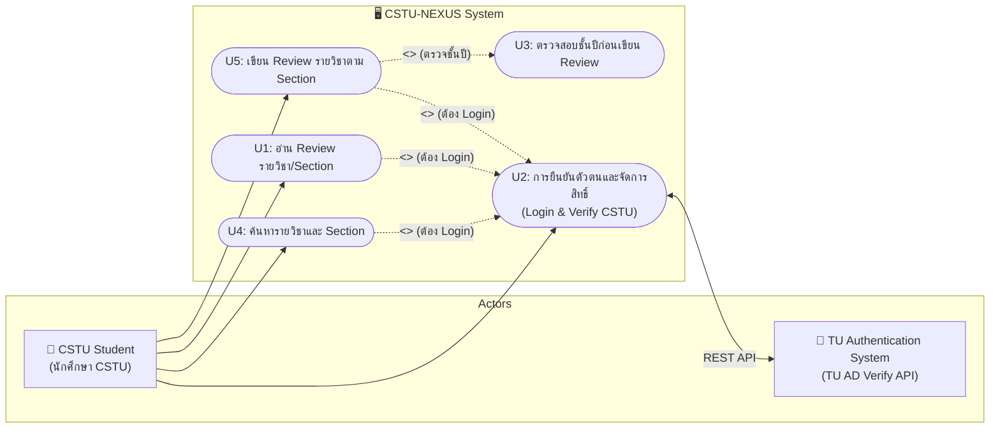
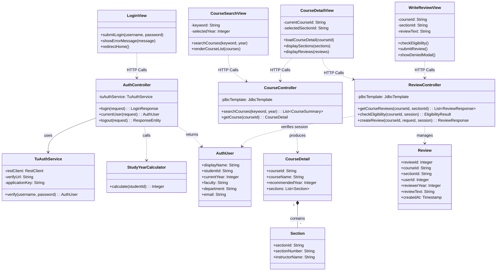

# CSTU-NEXUS — Use Case & Class Diagrams

เอกสารรวบรวม **Use Case Diagram** และ **Design Class Diagram** สำหรับระบบ **CSTU-NEXUS** อ้างอิงตามขอบเขตงาน U1–U5 และสถาปัตยกรรมแบบ **Boundary-Control-Entity (BCE) / Layered Pattern**

---

## สารบัญ
1. [Use Case Diagram & Actor Specifications](#1-use-case-diagram--actor-specifications)
2. [Design Class Diagram (BCE Pattern)](#2-design-class-diagram-bce-pattern)
3. [System Architecture & Deployment Overview](#3-system-architecture--deployment-overview)

---

## 1. Use Case Diagram & Actor Specifications

### 1.1 Use Case Diagram (CSTU-NEXUS)



### 1.2 ตารางรายละเอียด Use Cases (U1–U5)

| Use Case ID | ชื่อ Use Case | Actor หลัก | ความสัมพันธ์ | วัตถุประสงค์โดยสรุป |
|:---:|---|:---:|:---:|---|
| **U1** | อ่าน Review รายวิชาและ Section จากรุ่นพี่ | CSTU Student | `<<include>> U2` | เปิดดูประวัติรีวิวและคำแนะนำของแต่ละเซกชันจากรุ่นพี่ในหลักสูตร |
| **U2** | การยืนยันตัวตนและการจัดการสิทธิ์ | CSTU Student,<br>TU AD Verify API | - | ตรวจสอบรหัสนักศึกษาและรหัสผ่านผ่านระบบของมหาวิทยาลัย และคัดกรองเฉพาะ นศ. CSTU |
| **U3** | ตรวจสอบชั้นปีก่อนเขียน Review | CSTU Student (System Rule) | `<<included by>> U5` | ตรวจสอบว่าผู้ใช้มีชั้นปี $\ge$ ชั้นปีที่แนะนำ (`recommended_year`) ของวิชานั้นๆ หรือไม่ |
| **U4** | ค้นหารายวิชาที่ต้องการ และ Section | CSTU Student | `<<include>> U2` | ค้นหารายวิชาจากรหัส/ชื่อวิชา คัดกรองตามชั้นปี และดูรายชื่อเซกชันพร้อมผู้สอน |
| **U5** | เขียน Review รายวิชาตาม Section | CSTU Student | `<<include>> U2, U3` | กรอกข้อความรีวิวประสบการณ์การเรียนและส่งบันทึกแยกตาม Section |

---

## 2. Design Class Diagram (BCE Pattern)

แผนภาพแสดงโครงสร้างคลาสเชิงสถิต (Static Structure) แบ่งตามรูปแบบ **Boundary-Control-Entity (BCE)** สอดคล้องกับ Sequence Diagrams และการพัฒนาจริง:



---

## 3. System Architecture & Deployment Overview

ภาพรวมการวางระบบ (Deployment / Architecture View):

```mermaid
flowchart TD
    subgraph ClientTier ["🖥️ Client Tier (Frontend)"]
        Browser["Web Browser (Vanilla HTML5 / CSS3 / ES6 JavaScript)"]
    end

    subgraph AppTier ["⚙️ Application Tier (Backend)"]
        SpringBoot["Spring Boot 4.1.x (Java 17)<br/>- Spring Web MVC (REST APIs)<br/>- Spring JDBC (JdbcTemplate)<br/>- HttpOnly Session Security"]
    end

    subgraph DataTier ["🗄️ Data Tier (PostgreSQL)"]
        Postgres[("PostgreSQL 17 Database<br/>- courses, sections<br/>- mock_user, review")]
    end

    subgraph ExternalTier ["🌐 External Services"]
        TuAD["TU Authentication API<br/>(https://restapi.tu.ac.th)"]
    end

    Browser <-->|HTTP / JSON (REST APIs)<br/>Port 8080| SpringBoot
    SpringBoot <-->|JDBC (Port 5432)| Postgres
    SpringBoot <-->|HTTPS POST (Application-Key)| TuAD
```
